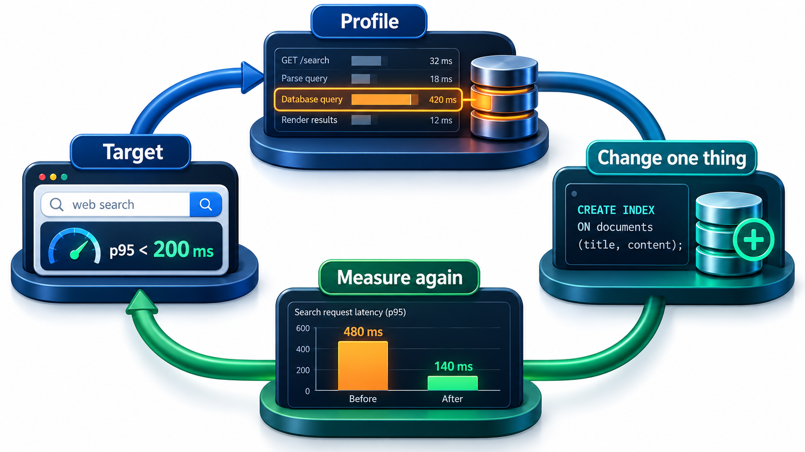
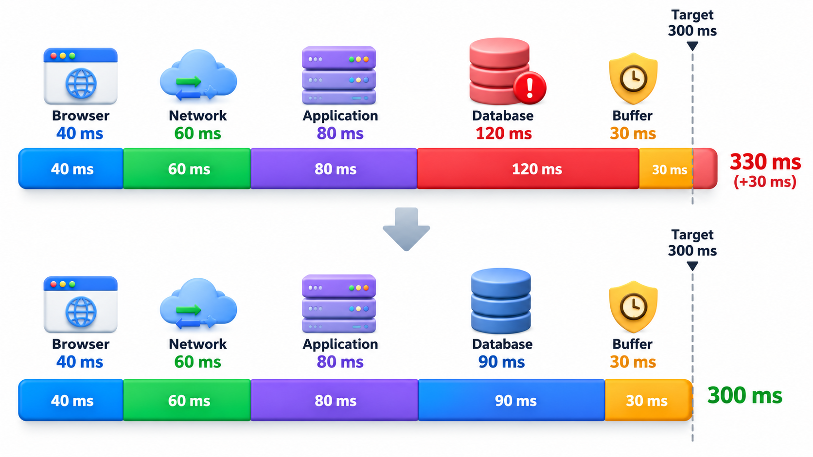
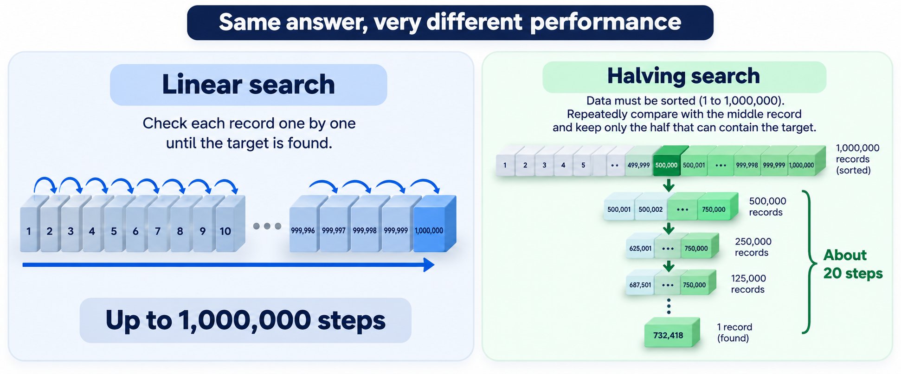
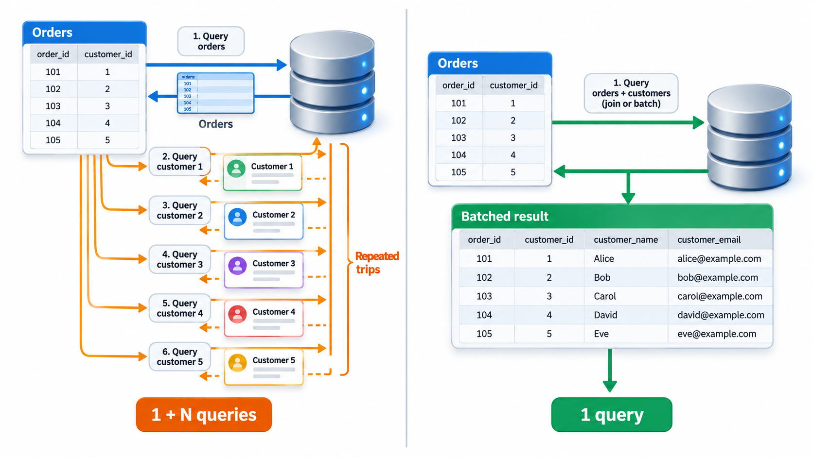
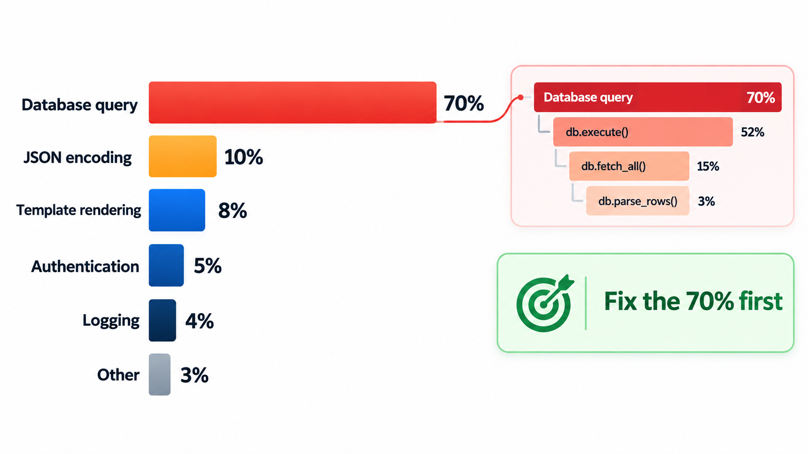

## Measure First, Then Change Only the Slow Part

Programmers are poor at guessing which part of a program is slow. Time spent making a function twice as fast is worth nothing if the program spends one per cent of its time in it. A famous remark says that premature optimisation is the root of all evil, but the full passage is more careful: forget small efficiencies about 97 per cent of the time, yet do not pass up the opportunities in the critical 3 per cent. The skill is to find that 3 per cent by measuring.

That is the heart of performance engineering. The discipline is to **measure first**, find the real bottleneck, change that and nothing else, and measure again. This topic lays out that method and the difference between the improvements that matter and those that do not.

The arithmetic behind the advice is Amdahl's idea in everyday form: the most you can gain from speeding up a part is limited by how much of the total that part is. If a function takes 5 per cent of the run time, making it infinitely fast saves only 5 per cent. If another takes 70 per cent, even halving it saves 35.

| Part | Share of run time | Speed-up applied | Total time saved |
| --- | --- | --- | --- |
| Formatting output | 5% | Made twice as fast | 2.5% |
| Parsing input | 25% | Made twice as fast | 12.5% |
| Database query | 70% | Made twice as fast | 35% |

## Measure Before You Change Anything

The cycle has four steps.

1. **Set a target.** "The results page should load in under two seconds for 95 per cent of users." Without a target, you cannot tell when to stop.
2. **Measure.** Find out where the time or memory really goes. Use a **profiler**, a tool that records how much time is spent in each function, or how often each is called. Measure with realistic data and on realistic hardware, since a program that is fast on ten rows can be slow on a million.
3. **Change one thing.** Fix the biggest cost found. Change nothing else, so you know what helped.
4. **Measure again.** Check that the change helped, and by how much. If not, undo it. Then repeat or stop.

Intuition is unreliable here. A programmer may spend a week speeding up a loop, and the profiler later shows that the program spends most of its time waiting for a database query. Ten minutes of measurement would have saved the week.

<!-- Visual: a loop with four steps, set a target, measure with a profiler, change one thing, measure again, with an arrow from the last step back to the second. Save as images/86_measure_change_loop.png. -->

## What to Measure

"Performance" covers several different things, and each has its own measure.

| Quality | Measure | Example target |
| --- | --- | --- |
| **Latency** | Time for one request to complete | 95% of page loads under 2 seconds |
| **Throughput** | Work done per unit of time | 500 requests per second |
| **Resource use** | Memory, processor, network | Under 1 GB of memory per server |
| **Scalability** | How the above change as load grows | Latency stays flat up to 10,000 users |
| **Start-up time** | Time until ready | Under 5 seconds |

Averages hide pain. If most requests take 100 ms but one in twenty takes 5 seconds, the average looks fine while one user in twenty is suffering. This is why targets are usually stated as **percentiles**: the 95th percentile is the time that 95 per cent of requests beat.

| Request times (ms) | Mean | 95th percentile |
| --- | --- | --- |
| 19 requests at 100 and 1 at 5,000 | 345 | 100 (the 99th percentile would be 5,000: the slowest user waits 50 times longer than the typical one) |

The practical lesson is to look at the slow tail, because that is what users complain about.

## Algorithms Beat Micro-tuning

When something is slow, the biggest gains come from using a better **algorithm**: a different way of doing the job that does less work as the data grows. Micro-tuning, such as writing a loop in a slightly faster way, usually brings gains of a few per cent. A better algorithm can bring a factor of a thousand.

The difference is how the work grows with the size of the input. A method that compares every item with every other takes about *n* squared steps for *n* items. For a hundred items that is ten thousand steps, which is fine. For a million items it is a trillion, which is not. A method that goes through the items once takes about *n* steps, and a million items take a million steps.

The biggest improvements usually come from a better approach, not from polishing the existing one. Take the job of finding whether a list of roll numbers contains a duplicate, in two ways. The slow way compares every pair of numbers. The fast way goes through the list once and keeps a record of the numbers it has seen, which can say whether a number is in it in a single step. Counting steps is more reliable than timing for comparison, because it does not depend on the speed of the machine. With no duplicates, which forces both to do their full work:

| Roll numbers | Slow way (comparisons) | Fast way (look-ups) |
| --- | --- | --- |
| 100 | 4,950 | 100 |
| 1,000 | 499,500 | 1,000 |
| 3,000 | 4,498,500 | 3,000 |

The slow method's work grows with the *square* of the size: tripling the data makes it about nine times slower. The fast method's work grows in step with the size. No amount of polishing the slow version's inner loop would close that gap, whereas changing the approach closes it at once. The exact times depend on the machine. The ratio of steps does not.

<!-- Visual: linear search taking up to one million steps compared with a sorted halving search taking about twenty steps. -->

## Where the Time Goes

Most slowness in real systems comes from a few usual suspects:

- **Repeated work.** The same calculation or query done again and again, for which a cache is the cure.
- **Too many round trips.** A page that makes two hundred small database calls when one would do. This is known as the N+1 query problem.
- **Waiting on slow things.** Disk, network and other services are a million times slower than memory. Reducing the number of such calls is worth more than any code tweak.
- **Doing too much.** Loading a whole table to show ten rows; sending a megabyte of data to show a name.
- **Memory pressure.** Using so much memory that the system slows down or fails.

Each is found by measurement. Each is fixed by doing less: fewer calls, less data, less repetition.

## The N+1 Problem Counted

A results page shows 50 students and, for each, their department name. A naive approach fetches the list of students (one query) and then fetches the department for each student separately (fifty more).

| Approach | Queries | Time if each takes 5 ms |
| --- | --- | --- |
| One query for students, then one per student | 1 + 50 = 51 | 255 ms |
| One query that joins students and departments | 1 | 5 ms |
| Two queries: students, then all needed departments together | 2 | 10 ms |

With 5,000 students the first approach makes 5,001 queries and takes 25 seconds. The structure of the work, not the speed of the machine, is the problem.

## Caching and Its Trade-offs

A **cache** keeps the result of earlier work so that it can be reused. It is among the most effective speed-ups, and the most frequent source of subtle bugs, because a cached answer can become stale.

| Question | Why it matters |
| --- | --- |
| What is cached? | Only things that are expensive and reused |
| How long is it valid? | A fee list may be cached for an hour; a bank balance hardly at all |
| What invalidates it? | A change to the underlying data must clear or update the copy |
| What if it is empty or full? | A cold cache is slow; a full one must evict something |
| Who else sees the stale value? | Users may see out-of-date information |

There is an old saying that there are two hard problems in computing: naming things and cache invalidation. The second part deserves respect.

## Know When to Stop

Performance work has a cost, and so does the faster code, which is often harder to read. So the target decides. If the page loads in 1.2 seconds and the goal is 2, the work is done. Fast code that nobody can maintain is a form of technical debt. A good practice is to write clear code first, measure, and optimise only the parts that the data shows are too slow, with a comment to explain the unusual structure and a benchmark to protect the gain.

Performance should also be treated as a requirement from the start, with a measurable target and a test that fails when it is missed, since slowness often creeps in change by change.

<!-- Visual: a flame graph or a bar chart of time per function for one request, with one tall bar labelled "database query: 70 per cent" and many tiny bars for everything else, showing why the biggest bar is the one to fix. Save as images/86_profile_bar_chart.png. -->

## Five Misreadings of Performance Engineering

**"Premature optimisation is evil, so never optimise."** The warning is against optimising without measuring. Optimising the measured bottleneck is the job.

**"Faster code is better code."** Faster than needed is waste, if it costs clarity.

**"I know where the slow part is."** Experienced engineers are often wrong. Profile first.

**"Tuning loops makes programs fast."** Changing the algorithm or reducing calls to slow resources does far more.

**"Performance is an end-of-project task."** The structure of a system sets its limits. Check early, and keep a test that watches it.
