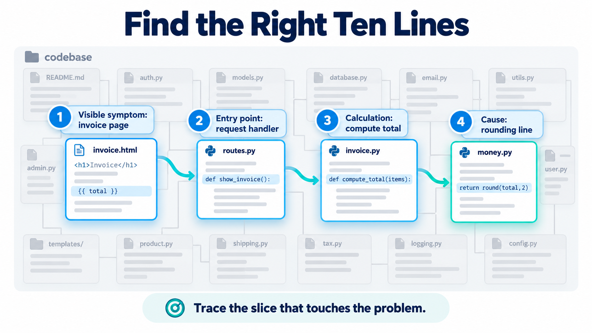
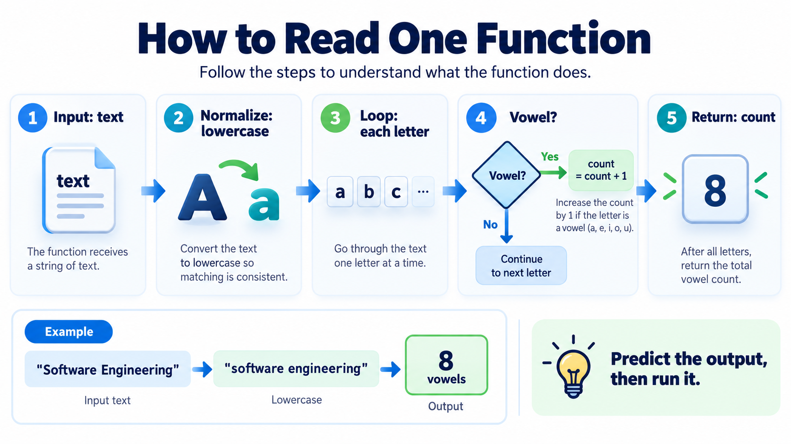
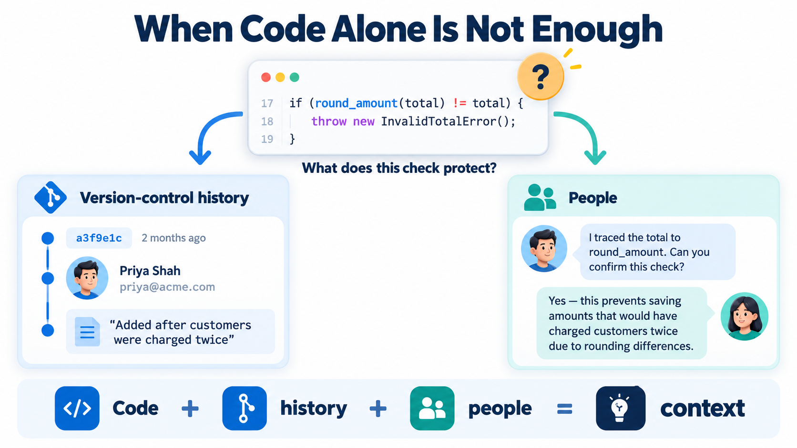
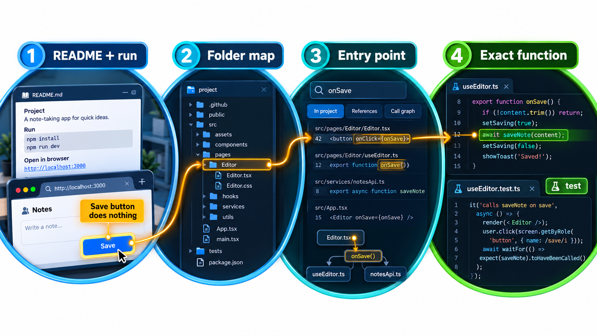
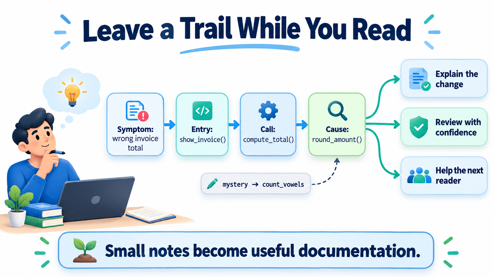

## Almost Nobody Starts From a Blank Page

The usual first day in a job is different from a course exercise: a laptop is handed over, a repository is cloned, and there are thousands of files that other people wrote over many years, with no one who has time to explain all of it. Studies of how professional developers spend their time repeatedly find that a large share, often well over half, goes on reading and understanding existing code, and only a minority on writing new code.

Finding your way around a system you did not write is one of the most valuable and least taught skills in software. Someone fixing a small bug must first find the right file among thousands, learn the conventions, work out what the code around it does, and make a change small enough to be accepted. This topic describes how experienced developers do this, as a set of habits you can start using on any codebase.

The skill is closer to detective work than to writing. You gather clues, form a guess about where the answer lies, test it, and narrow down. The code is the scene, the tests and history are witnesses, and the colleagues are people who may remember what happened.

## Start with the Outside

Before reading any code, learn what the system is for and how it is used. Read the README and any architecture notes. Install it and run it. Use the product. Look at the tests, which are examples of what the system is supposed to do. Browse the folder structure: the names of the top-level directories often show the main parts. This gives you a map, so that when you do read the code you know where in the larger picture you are.

| Source | What it tells you | Time |
| --- | --- | --- |
| README and docs | Purpose, set-up, vocabulary | 15 minutes |
| Running the product | What users see and do | 15 minutes |
| Folder layout | The main parts and their names | 10 minutes |
| Tests | Expected behaviour with examples | 20 minutes |
| Recent history | What the team is currently changing | 10 minutes |
| A colleague's overview | Context no document holds | 30 minutes |

## Find the Right Lines

A big codebase cannot be read from top to bottom, and you do not need to. The skill is to find the few lines related to your task and ignore the rest. Several techniques work together.

- **Search.** Text search for an error message, a label on a screen or a function name takes you straight to the relevant code. If the screen says "Fee overdue", search for that phrase.
- **Start from an entry point.** Find where the feature starts: the route for a web address, the handler for a button, the command in a script. Follow the calls from there.
- **Read the tests.** A test for the feature shows how the code is meant to be called and what results to expect.
- **Use the tools.** An editor's "go to definition" and "find all references" follow the connections between pieces.
- **Run it.** A debugger or a few well-placed print statements show the path through the code as it actually executes.

<!-- Visual: A focused path from the visible symptom through an entry point to the exact line to change. -->

## A Worked Search

Suppose the task is "the overdue message shows the wrong amount for students with scholarships". How would you find the code?

| Step | Action | Finding |
| --- | --- | --- |
| 1 | Search the whole code for the text "Fee overdue" | Two matches: a template file and a test |
| 2 | Open the template; see which variable it prints | `amount_due` |
| 3 | Search for where `amount_due` is set | One function in the billing module |
| 4 | Read that function and its caller | It ignores the scholarship field |
| 5 | Find the test for the function | It covers non-scholarship students only |
| 6 | Write a failing test for a scholarship student | Reproduces the bug |
| 7 | Make the smallest fix; run all tests | Passes |

Seven steps, and in none of them did the reader need to understand the whole system. Each step narrowed the search by following a thread: from the visible text to the variable to the function to the test.

## Trace Execution

One of the quickest ways to understand an unfamiliar flow is to watch it run. The simplest tool is to make each step announce when it is called and what it returns. Follow a checkout of Rs 500 through three steps:

| Step | Called with | Returns |
| --- | --- | --- |
| Checkout | 500 | Passes the amount to the final price step |
| Final price | 500 | Asks the discount step to apply 10 per cent |
| Apply discount | 500 and 10 | 450.0, which passes back out through the others |

Reading the trace from the top gives the path without reading any of the code: checkout calls final price, which calls apply discount with the amount and 10. You now know the call order, the arguments and the result. If the answer were wrong, you would see at which step the number went astray. Debuggers and profilers do this without editing the code, and show far more, but the principle of making the invisible path visible is the same. Remove any temporary trace when you are done, or keep what is useful as proper logging.

## Read One Function Carefully

At some point you do have to read a function. A method that works is to go slowly and write down what you find. What are the inputs? What does each line do to them? What is returned, and what can go wrong? Run it by hand with a small example. Predict the output before you run it, then check. A wrong prediction is the most efficient kind of learning, because it points straight at a misunderstanding.

| Question to ask of a function | Why |
| --- | --- |
| What goes in, and what are the units? | Misreading inputs is the commonest error |
| What comes out in each case? | Includes the empty and error cases |
| What else does it change? | Hidden effects on other data |
| What does it call, and what calls it? | Its place in the larger flow |
| What would break if I changed it? | The blast radius of the edit |

<!-- Visual: A step-by-step approach to reading one function and predicting its output. -->

## Learn the Conventions

Every codebase has its own style, which is more than the formatting. How are errors handled? Where do configuration values live? How are tests named, and how are modules arranged? What is the word they use for a customer? A change that fits the conventions is easy to review and to merge. A change that ignores them, however clever, makes more work for the maintainers. So before you write anything, look at three or four similar pieces of code and imitate them.

## Change Code You Do Not Fully Trust

Legacy code often has no tests and unclear behaviour. Changing it safely follows a pattern.

| Step | Purpose |
| --- | --- |
| 1. Find the smallest place that needs to change | Limits the area at risk |
| 2. Write tests that record what it does now (characterisation tests) | A net against accidental change |
| 3. Make the change as small as possible | Fewer things to go wrong |
| 4. Run the tests, then check by hand | Both automated and human confirmation |
| 5. Leave the area slightly tidier | Each visit improves the next |
| 6. Put structural clean-up in a separate change | The reviewer can tell behaviour from tidying |

## Use History and People

The code shows what is. The history shows why. `git log` on a file lists the changes that shaped it, and `git blame` shows who last changed each line and in which commit, with the message that explains it. A strange check may turn out to be there for a bug fixed three years ago, and its commit message and linked issue tell the story. The people are as valuable: asking a colleague "why does this work this way?" can save a day. Do your homework first, so the question is specific.

| Question | Where the answer may be |
| --- | --- |
| Why does this odd line exist? | `git blame`, then the commit message and linked issue |
| Who knows this module? | The most frequent authors in the history |
| What changed recently around here? | `git log` for the folder |
| Has this been tried before? | Closed issues and pull requests |
| What did people decide? | Decision records and review comments |

<!-- Visual: version history and team members as sources of context that code alone cannot give. -->

## Make Your First Contribution

A good first change is small, safe and useful. Many projects mark suitable issues with a label such as "good first issue". Fixing a typo in documentation, clarifying an error message, or adding a missing test are all legitimate and welcome starts. The usual steps are:

1. Read the contributing guide, which says how to set up, test and submit.
2. Pick a small issue and say you are working on it.
3. Make the change on a branch, following the conventions.
4. Run the tests and the linter.
5. Open a pull request with a clear description: what, why and how you tested.
6. Respond politely to the review, and make the changes asked for.

The first one is as much about learning the process as about the change. After it, the next is much easier.

<!-- Visual: a map of an unfamiliar codebase drawn from outside in: README and running the product, then folders, then an entry point, then the single function to change, with the tools used at each stage. Save as images/87_outside_in_map.png. -->

## Leave a Trail

As you learn, write down what you discover: a sketch of the main parts, a list of the commands you needed, notes on the confusing bits. When you have understood a function, improve its name or add a comment saying why. Add a test for behaviour you had to work out. These small acts help the next person, who may well be you in six months, and many projects are glad to accept such improvements.

<!-- Visual: notes and tests left behind as a trail for the next reader. -->

## Five Misreadings of Working with Existing Code

**"I must understand everything before I change anything."** You need to understand the part you are changing and what depends on it. The rest can wait.

**"Reading code is a waste of time compared with writing it."** It is most of the job. Skill at it is a large part of what makes engineers productive.

**"Messy code means the authors were bad."** It usually means the code was shaped by deadlines and changing needs. Be curious about why before you criticise.

**"I should fix everything I see."** Keep the first change small and focused. Report or note the rest for separate changes.

**"Asking questions shows weakness."** Specific questions asked after some effort save everyone time. Teams generally prefer a good question to a long silence.
