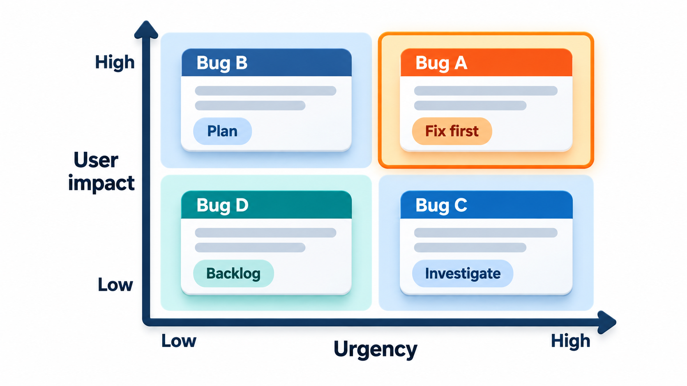
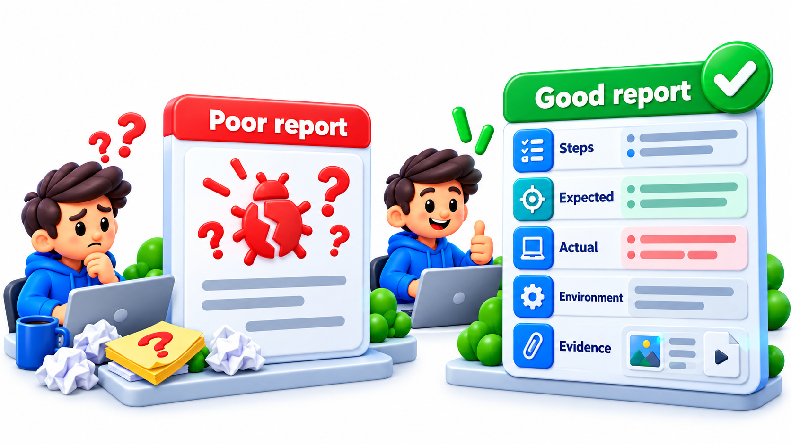
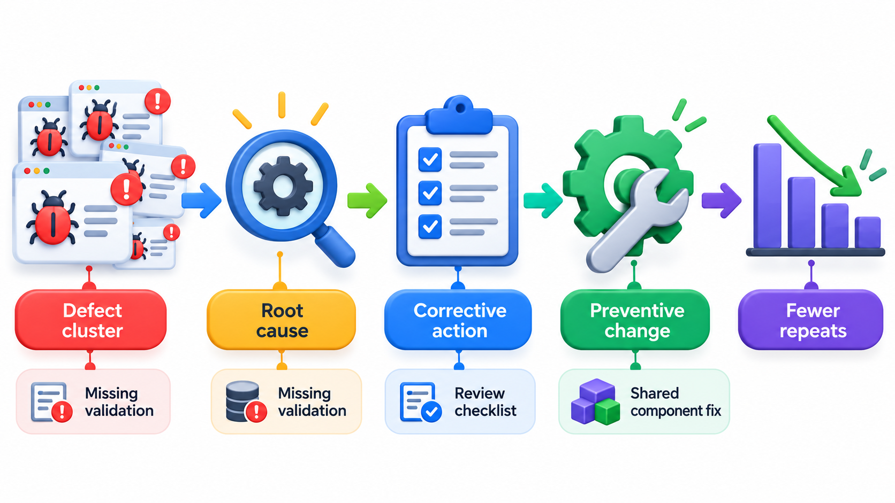
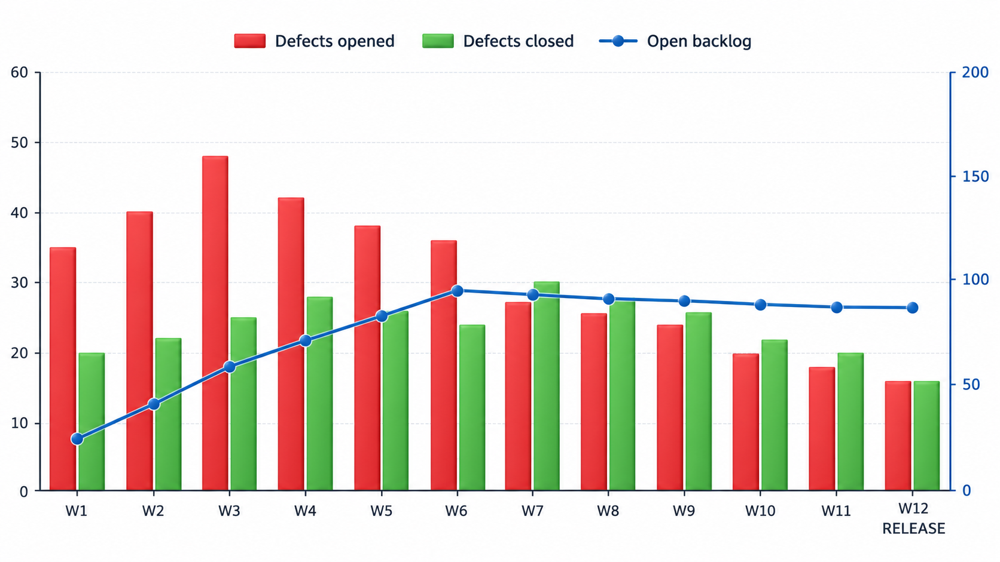

## Write the Defect Down

Every defect found has a life. Someone notices it, someone judges how serious it is, someone decides when to fix it, someone fixes it, and someone checks the fix. If none of this is recorded, defects are lost, argued about from memory, fixed twice or never, and nobody can say whether the product is getting better. The habit that matters more than any tool is to *write it down*: the time, the cause, the fix.

**Defect management** is the practice of recording every defect and following it through to its end. This topic covers what a good defect report contains, the life cycle a defect passes through, and how to decide the order in which defects are fixed.

A defect tracker is also the team's memory. Months later, someone asks why a strange check exists or whether a certain problem has been seen before. The answer is in the record, with the steps, the cause and the fix.

## The Life of a Defect

A defect found and not recorded is easily forgotten. A defect recorded without a plan can lie forgotten in a list. Teams therefore track each one through a **life cycle**, with defined states and responsibilities.

1. **New.** Someone reports it.
2. **Triaged.** The team checks that it is a real, reproducible defect and not a duplicate, and decides its severity and priority.
3. **Assigned.** A developer takes it on.
4. **In progress.** The developer investigates and fixes.
5. **Fixed.** The fix is made and ready to check.
6. **Verified.** A tester confirms the fix works and that nothing else broke.
7. **Closed.** Done, with a record of what was changed.

There are side exits: **rejected** when it turns out not to be a bug, **duplicate** when it was already reported, **deferred** when it will be fixed later, and **reopened** when verification shows the problem is still there. A tracking tool, such as Jira, Bugzilla or an issue tracker on GitHub, records the state, the history and the discussion for each defect.

| State | Who acts | Typical exit |
| --- | --- | --- |
| New | Reporter | To triaged |
| Triaged | Triage group | To assigned, rejected, duplicate or deferred |
| Assigned | Developer | To in progress |
| In progress | Developer | To fixed |
| Fixed | Tester | To verified, or reopened |
| Verified | Tester or lead | To closed |
| Reopened | Developer | Back to in progress |

<!-- Visual: A bug moving from discovery through verification to closure. -->

## Severity and Priority Are Different

Two labels are applied to every defect, and confusing them causes many arguments.

**Severity** is the *technical impact* of the defect: how badly it harms the system. It is usually judged by the tester or developer. A common scale runs from critical (crash, data loss, security hole) through major and minor to trivial (a typo).

**Priority** is the *urgency of fixing it*: how soon it should be dealt with. It is a business decision, made by the product owner or manager, who considers users affected, deadlines and cost.

The two do not always match.

| Defect | Severity | Priority | Why |
| --- | --- | --- | --- |
| The company name on the front page is misspelt | Low | High | Harmless to the system, embarrassing to the business, quick to fix |
| The system crashes when exporting a report that nobody uses | High | Low | Serious in itself, but affects almost no one |
| Payments are taken twice | High | High | Serious and urgent |
| A rarely used setting has a slightly wrong label | Low | Low | Fix when convenient |

Severity (how bad the technical effect is) and priority (how urgent it is for the business) are separate questions, and a triage meeting orders defects by priority first, then by severity within a priority. Take five defects, with severity from 1 (worst) to 4 and priority from 1 (fix now) to 3.

| Order | Defect | Severity | Priority |
| --- | --- | --- | --- |
| 1 | Payment taken twice | 1 | 1 |
| 2 | Receipt shows wrong total | 2 | 1 |
| 3 | Typo on login page | 4 | 1 |
| 4 | Crash when exporting 10,000 rows | 1 | 2 |
| 5 | Slow report on old laptops | 3 | 3 |

The double payment (priority 1, severity 1) comes first. The wrong receipt total comes second. The typo on the login page, whose severity is minor but whose priority is 1 because of an approaching demo, comes third, ahead of the export crash, which is severe but not urgent. The ordering is a business judgement. Teams adjust it as they see fit. The point is that there are two separate questions, and the order depends on both.

<!-- Visual: bug triage separating technical impact from urgency. -->

## Triage: Deciding What to Do

A triage meeting, often short and regular, looks at new defects and decides their fate. A simple set of questions guides it.

| Question | If the answer is... | Action |
| --- | --- | --- |
| Is it reproducible? | No | Ask for more information; park it |
| Is it a duplicate? | Yes | Link to the original; close |
| Is it really a defect, or the intended behaviour? | Intended | Reject, and consider whether the requirement is clear |
| How many users does it affect? | Many | Raise priority |
| Is there a workaround? | Yes | Priority may fall |
| How costly is the fix? | Very high for low impact | Defer, with a note |
| Does it block testing or release? | Yes | Fix now |

Good triage prevents two common faults: the list that grows without being read, and the loud defect that gets attention while a quiet but costly one is ignored.

## Writing a Report That Gets Fixed

A bug report is a message to someone who does not know what you saw. A developer who can reproduce a problem in five minutes will fix it. One who cannot will ask questions, wait, or close it. A useful report has:

- **A clear title.** "Receipt shows total of 200000 instead of 2000 for roll number 1042" and not "Receipt wrong".
- **Steps to reproduce.** Numbered, exact and starting from a known state: "1. Log in as a student with a fee due. 2. Open Pay Fee. 3. Pay by UPI."
- **Expected result.** What should have happened.
- **Actual result.** What did happen, with the exact message, a screenshot or a log extract.
- **Environment.** The version, device, browser, operating system and anything else relevant.
- **Frequency.** Every time, or sometimes? If sometimes, what seems to change it?
- **Severity and any workaround.**

A bug that cannot be reproduced is the hardest kind. The report should say what was tried, include logs and note anything unusual at the time. A good report also stays about one problem, and speaks about the product, not the programmer.

| Poor report | Better report |
| --- | --- |
| "Payment does not work" | "Payment of Rs 5,000 by UPI for roll 1042 returns 'Error 500' after 20 seconds" |
| "It crashed" | "App closes when tapping Download on the results page; Android 12, version 3.4.1; every time" |
| "Fix the report" | "Report total for Physics shows 1,200 but the rows add to 1,250" |
| "The developer broke login" | "Login fails with correct password after the 2 June build; works on the 1 June build" |

<!-- Visual: A useful bug report providing evidence and reproducible detail. -->

## Reproducing and Isolating

Part of a tester's skill is to turn a vague failure into a precise one. Narrowing a problem down before reporting it saves the developer hours.

| Technique | What it does | Example |
| --- | --- | --- |
| **Minimise** | Remove steps until the smallest sequence that still fails remains | Failure needs only "pay twice quickly", not the whole journey |
| **Vary one thing** | Change one condition at a time | Same steps on another browser; same on another account |
| **Find the last good version** | Identify when it last worked | Works in version 3.3, fails in 3.4: the change is between |
| **Collect evidence** | Logs, screenshots, network traces | Attach the error log from the time of failure |
| **Check data dependence** | Does it depend on the record? | Fails for names with an apostrophe only |

The "last good version" idea can be automated by searching the version history for the exact change that introduced the failure, which gives the developer the cause almost directly.

## Metrics for Defects

Counts and rates from the defect record give a picture of progress and quality, as long as they are read with care.

| Measure | What it shows | Caution |
| --- | --- | --- |
| **Defects found per week** | Whether discovery is slowing | Slowing may mean testing has stopped finding things |
| **Open defects by severity** | The backlog and its risk | Count alone hides age |
| **Defect density** | Defects per thousand lines or per feature | Depends on size measure |
| **Defect removal efficiency** | Share found before release | Needs post-release defects to be recorded |
| **Mean time to fix** | How quickly the team responds | Easy to game by closing quickly |
| **Escape rate** | Defects found by users | The ultimate test of testing |

Defect removal efficiency is easy to compute: if testing found 90 defects and users later found 10, the efficiency is 90 out of 100, or 90 per cent. A team can track it release by release.

## Learning from the Defects

A defect list is data. Looking across it reveals where defects cluster, which phase introduced them, which kind of testing found them and how long they take to fix. Such a review is called **root-cause analysis** when applied to a single serious failure: asking "why" repeatedly until the underlying cause appears, not just the immediate trigger. A defect in the late fine calculation may trace back to an unclear requirement, which traces back to a missed conversation with the accounts office. Fixing the code stops that bug. Fixing the conversation stops the next one.

Teams also watch counts over time: defects found and fixed per week, open defects by severity, and the number found after release. A curve of new defects that flattens near the end of a release suggests stability, and one that is still rising suggests that more are waiting.

| Why? | Answer |
| --- | --- |
| Why did students see a fine of zero for late payments? | The fine function returned 0 for dates with a month ending in 7 |
| Why did the function do that? | A remainder test was written wrongly |
| Why was it not caught in testing? | Tests used only a few sample dates |
| Why were only a few used? | No boundary analysis was done for this function |
| Why not? | The test plan did not list it as a risk area |

The fifth answer is about process, and fixing it (reviewing the test plan for risk areas) prevents a class of future defects, not just this one.

<!-- Visual: a chart over twelve weeks of defects opened and defects closed, with the cumulative open count rising then flattening before a release, and a marker for the release date. Save as images/100_defects_open_and_closed.png. -->

