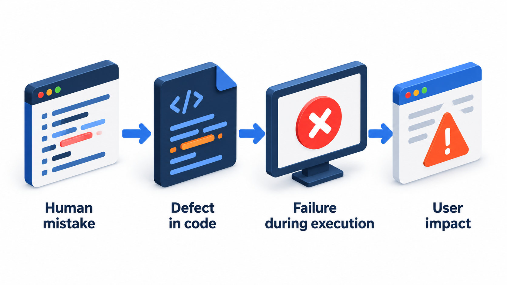
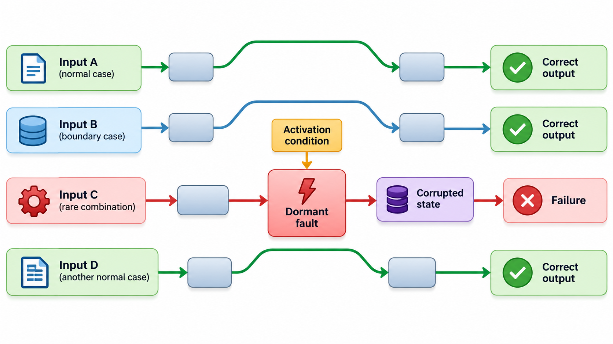
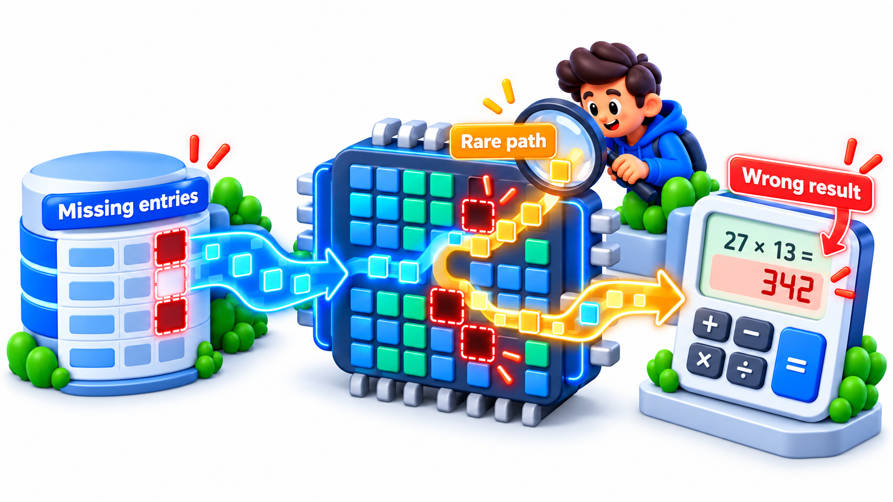
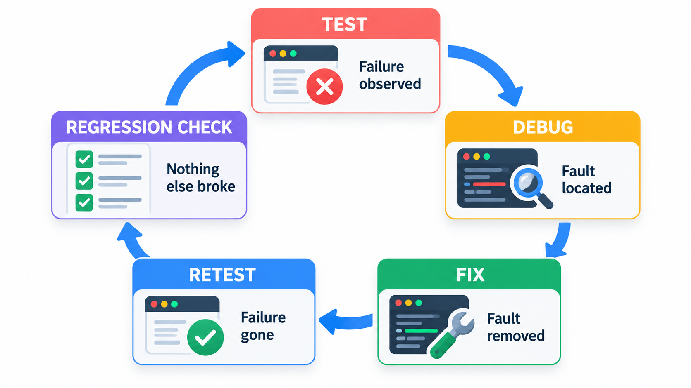

## Three Words That Mean Different Things

People use "bug" for everything that goes wrong, but testing depends on telling three things apart. A person makes a **mistake**, for example while designing a part or writing a rule. That leaves a **fault** in the work: a wrong rule, a missing table entry, a misplaced condition. Most of the time the fault does nothing at all. But on a particular input it produces a **failure**: a visible wrong answer or a crash.

The distinction explains why testing is hard. A fault can sit unseen for years because only a rare input reaches it. A processor once shipped with a handful of missing entries in an internal table, and an ordinary user would have met the resulting wrong answer about once in billions of divisions. Understanding the difference between mistake, fault and failure is the foundation of testing.

## Mistake, Fault, Failure

Testers use three terms, and they describe three stages of one chain.

| Term | What it is | In the missing-table-entries example |
| --- | --- | --- |
| **Error (mistake)** | A human slip in understanding or doing | The engineer who generated the table missed five entries |
| **Fault (defect, bug)** | The flaw this leaves in the product | Five missing values in the lookup table |
| **Failure** | The visible wrong behaviour when a fault is triggered | A division giving a result that is wrong in the ninth significant digit |

Notice the gaps in the chain. A mistake does not always leave a fault, because a reviewer may catch it. A fault does not always cause a failure, because the faulty code may never run or the wrong input may never arrive. A failure is only seen when a fault is *executed* by an input that *exposes* it. That is why a program can have a fault for years without anyone noticing, and why users and testers can disagree about whether a product "has bugs".

<!-- Visual: a chain of three boxes, mistake leading to fault leading to failure, with side arrows showing the mistake caught by review, the fault never executed, and the failure noticed by a user. -->

## Following the Chain in an Ordinary Program

The chain is not limited to famous cases. Take an everyday example from a college fee system.

| Stage | What happened | Where it lives |
| --- | --- | --- |
| **Mistake** | A developer reads "late after the due date" and writes the comparison as "on or after" | In the developer's understanding |
| **Fault** | The condition says "on or after" where "after" was meant | In the code |
| **No failure yet** | Students who pay before the due date are fine; so are those who pay later | The fault is present, but no input exposes it |
| **Failure** | A student pays exactly on the due date and is charged a fine | Seen by the user |

Only students who pay on the exact due date meet the failure, perhaps one in thirty payers. A test suite that tries an early payment and a late payment passes. The boundary case is the one that exposes the fault, which is why testers pay particular attention to boundaries.

## Where Faults Come From

Faults are introduced at every stage of development, not only in code. Studies of defects find that a large share originate before a line of code is written.

| Stage | Typical fault | Example |
| --- | --- | --- |
| **Requirements** | Missing, ambiguous or conflicting requirement | "Send a reminder" with no word on how often |
| **Design** | Wrong structure or interface | Two modules disagreeing on units |
| **Coding** | Wrong logic, typos, misuse of a language feature | An off-by-one in a loop |
| **Configuration** | Wrong setting or environment | A test database address left in production |
| **Data** | Bad or unexpected input | A name with an apostrophe |
| **Documentation** | Instructions that mislead | A set-up guide with a missing step |

The practical conclusion is that review and testing should begin with the requirements. A fault in a requirement is built faithfully into every later stage and found, if at all, at great cost.

## Why Testing Cannot Prove the Absence of Bugs

Edsger Dijkstra, a pioneer of computer science, put the central limitation of testing in a sentence around 1970: testing can show the presence of bugs, but never their absence. A test that fails proves a bug exists. A thousand tests that pass prove only that those thousand cases work.

The reason is arithmetic. The number of possible inputs to even a small program is astronomical. A function that takes two 32-bit numbers has about 18 quintillion input pairs. No one can try them all. Tests sample the possibilities, and a rare fault hides in the cases not sampled.

Imitate such a problem in miniature. A fee-discount rule gives everyone a discount of 100, except roll numbers ending in 777, which are wrong and get 0. That is one roll number in every thousand.

| Way of testing | What is tried | Result |
| --- | --- | --- |
| Eight hand-picked tests (rolls 101, 250, 999, 1,500, 4,321, 6,000, 7,123, 9,050) | None ends in 777 | All 8 pass, and a team might happily ship |
| Exhaustive check of every roll from 1 to 10,000 | Every case | 10 failures: 777, 1,777, 2,777 and so on |

The eight tests were not careless; they were just a small sample. The chance that eight random roll numbers hit a one-in-a-thousand case is under one per cent. Exhaustive testing is possible here only because the input is small. For real inputs it is not, which is why testers choose their cases deliberately, with the techniques described in this topic, rather than at random. Testing can show that faults exist; it can never prove that none remain.

<!-- Visual: A rare processor-table defect corrupting one unusual calculation path. -->

## How Many Tests to Find a Rare Fault?

The chance of finding a fault with random tests follows simple probability. If a fault is triggered by a fraction p of inputs, the chance that n independent random tests all miss it is (1 - p) to the power n.

| Fraction of inputs that expose the fault | Random tests for a 50% chance of finding it | For a 95% chance |
| --- | --- | --- |
| 1 in 10 | 7 | 29 |
| 1 in 100 | 69 | 299 |
| 1 in 1,000 | 693 | 2,995 |
| 1 in 1,000,000 | About 693,000 | About 3 million |

A fault that appears once in a million inputs needs millions of random tests to be found reliably. This is the reason testers choose cases cleverly, using boundaries, equivalence classes and risk, instead of drawing inputs at random. It is also why such faults, once released, can run for years: each user is unlikely to hit them, yet among a million users somebody will.

## What Testing Is For

If testing cannot prove correctness, what is it for? It has three useful jobs. It **finds failures**, so they can be fixed before users meet them. It **reduces risk**, since the more varied and thoughtful the tests that pass, the less likely a serious defect remains. And it **provides information**: about how the product behaves, so that the people deciding whether to release can do so with eyes open. Testing is a way of gathering evidence about quality, and not a stamp of approval.

Good testers think about where faults are likely to hide: at boundaries, in rarely used paths, in combinations of conditions, in the interactions between parts. They use varied techniques, as a net with different mesh sizes catches different fish.

<!-- Visual: layered tests acting as a risk net that reduces but does not eliminate defects. -->

## Testing and Debugging Are Different Jobs

The two words are often confused.

**Testing** is the activity of *finding* failures. It asks "does the program behave as expected?" and its output is a list of failures with evidence.

**Debugging** is the activity of *locating and removing the fault* that caused a failure. It asks "why did this happen, and what must change?" and its output is a fix.

They are done by different thinking and often by different people. A tester discovers that the fee for roll number 1777 is zero. A developer then debugs: traces the calculation, finds the remainder test, and corrects it. After the fix, testing returns to confirm that the failure is gone and that nothing else broke. The two activities form a loop.

| Activity | Starting point | Output | Typical person |
| --- | --- | --- | --- |
| **Testing** | The product and a plan | Evidence of failures | Tester, or developer writing tests |
| **Debugging** | A reported failure | Understanding of the cause and a fix | Developer |
| **Retesting** | The fix | Confirmation that the failure is gone | Tester |
| **Regression testing** | The fixed product | Confirmation that nothing else broke | Tester, usually automated |

<!-- Visual: a loop with testing finding a failure, debugging locating and removing the fault, and retesting confirming the fix and checking nothing else broke. Save as images/88_test_debug_retest_loop.png. -->

## Five Misreadings of Errors, Faults and Failures

**"If the tests pass, there are no bugs."** They show only that the cases tried work. Rare faults hide in the cases not tried.

**"A bug and a failure are the same."** A bug (fault) is in the code. A failure is what the user sees when the bug is triggered. Many bugs never cause one.

**"Testers fix the bugs."** Testers find and report them. Developers debug and fix. Testers then check the fix.

**"More tests always mean better quality."** More varied, better chosen tests do. A thousand copies of the same check add nothing.

**"A rare bug is not worth fixing."** A processor flaw that struck about once in billions of divisions still cost its maker half a billion dollars. Rarity matters less than the consequence and the damage to trust.
