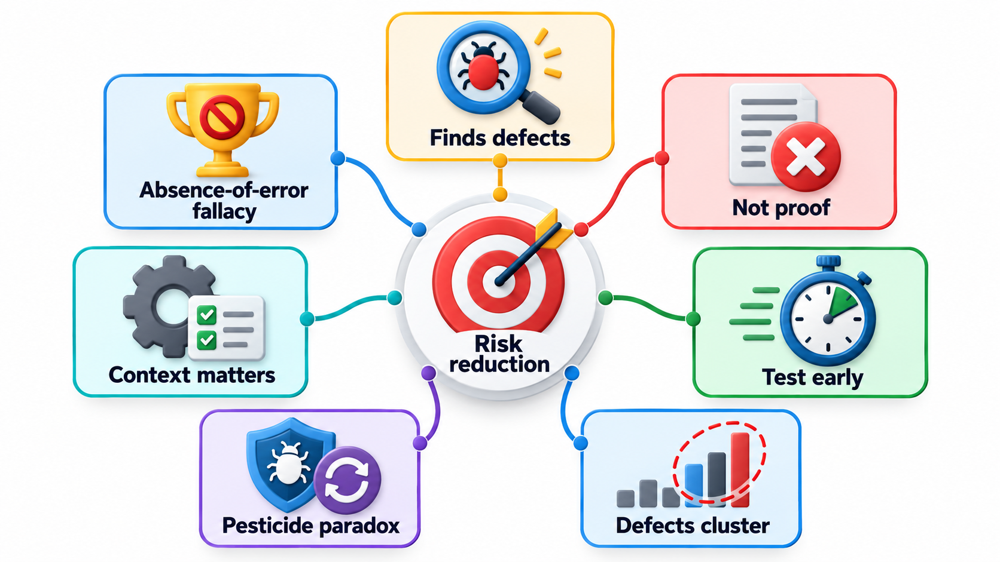
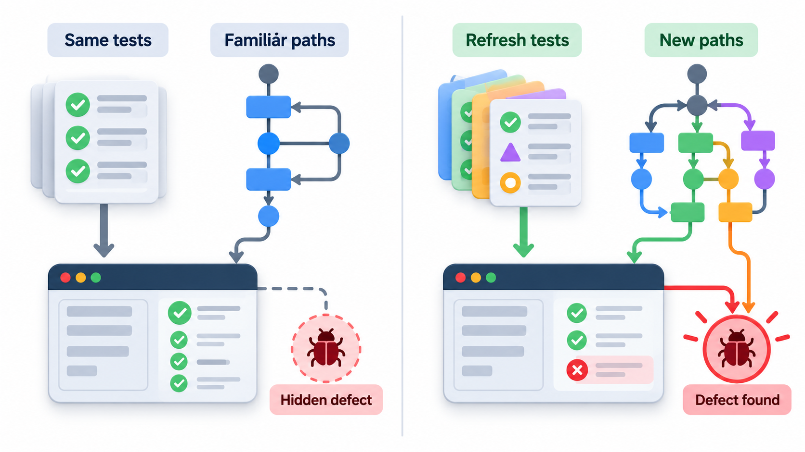
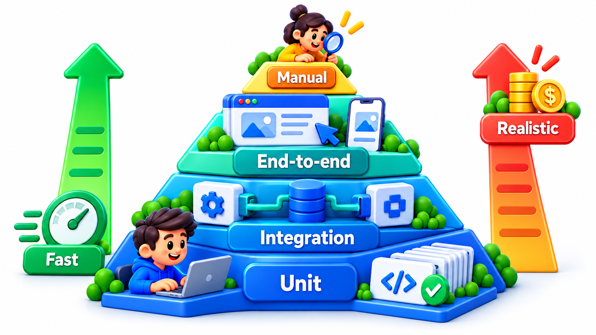
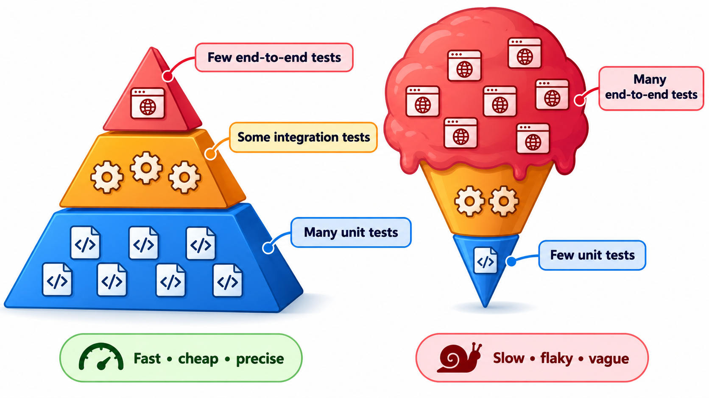

## Seven Ideas That Give Testing a Sense of Proportion

Testers cannot test everything, so they need guidance about where to spend effort. Years of experience have been summarised as seven principles by the International Software Testing Qualifications Board: testing shows the presence of defects but not their absence; exhaustive testing is impossible; test early; **defects cluster**; tests wear out when repeated unchanged (the pesticide paradox); testing depends on context; and "no defects found" does not mean the right product.

The clustering is the easiest to feel. Anyone who has worked on a large program knows that the same few files keep turning up in bug reports; in studies of large systems something like eighty per cent of the defects tend to sit in about twenty per cent of the modules. The exact numbers vary, but the pattern holds often enough to be a principle. This topic covers them, and then the best-known picture of how to balance tests of different kinds: the test pyramid.

## Seven Principles

**1. Testing shows the presence of defects, not their absence.** Passing tests reduce the probability of hidden bugs, and they never reduce it to zero.

**2. Exhaustive testing is impossible.** Except for trivial programs, you cannot try every input and every path. Testing must be selective, guided by risk and by technique.

**3. Early testing saves time and money.** Testing activities should begin as early as possible: reviewing requirements and designs is testing too. A defect found in a requirement costs a fraction of one found in production.

**4. Defects cluster together.** A small number of modules hold most of the faults. Once an area has shown trouble, test it harder, and keep an eye on its neighbours.

**5. Beware the pesticide paradox.** If you run the same tests over and over, they stop finding new bugs, just as insects become resistant to the same pesticide. Tests need to be reviewed and refreshed, with new cases added as the code changes.

**6. Testing is context dependent.** A game, a banking system and a pacemaker are tested differently. How much, how carefully and by what methods depends on what failure would cost.

**7. The absence-of-errors fallacy.** Finding and fixing many bugs does not make a system useful. A product that passes every test but does not meet the users' needs has failed.

These can be recalled as a set of working attitudes: be selective, start early, follow the bugs, vary the tests, fit the effort to the context, and never forget what the product is for.

<!-- Visual: layered tests catching defects at different levels and reducing risk. -->

## Seeing Clustering in Data

Defect clustering can be checked in any project that records its bugs. Suppose a system has ten modules and 100 reported defects.

| Module | Defects | Share | Cumulative share |
| --- | --- | --- | --- |
| Fees | 34 | 34% | 34% |
| Reports | 22 | 22% | 56% |
| Login | 14 | 14% | 70% |
| Notifications | 9 | 9% | 79% |
| Import | 7 | 7% | 86% |
| Others (5 modules) | 14 | 14% | 100% |

The top three modules, 30 per cent of the modules, hold 70 per cent of the defects. A team that spreads its test effort evenly gives Fees the same attention as the quietest module. A team that follows the data gives Fees and Reports extra reviews, more tests and more careful changes. The same chart can be redrawn every release, and the shape usually stays similar.

## The Pesticide Paradox at Work

A regression suite of 500 tests that has not changed for two years still passes. It is natural to feel safe, yet the suite checks only what it checked two years ago. The product has changed, new features have appeared and new kinds of input have arrived.

| Year | Tests in suite | New bugs found by the suite | Bugs found by users |
| --- | --- | --- | --- |
| 1 | 300 | 45 | 12 |
| 2 | 500 | 12 | 20 |
| 3 | 500 (unchanged) | 2 | 31 |

The suite found fewer bugs each year while users found more, which is the sign of the paradox: the suite had stopped probing the areas where the bugs now were. The remedy is regular review: add tests for each new feature and for each bug found in production, retire redundant ones, and vary the data.

## A Pyramid of Tests

Tests come in different sizes. A **unit test** checks one small piece of code in isolation, such as the function that calculates a late fine. It runs in milliseconds, needs no database or network, and when it fails it points at a small area. An **integration test** checks that several parts work together, for example the fee module with a real database. It is slower and its failures are broader. An **end-to-end test** drives the whole system as a user would, through a browser, from login to receipt. It is the most realistic and the slowest, and when it fails it may take effort to find out why.

Mike Cohn described how to balance them in his 2009 book on agile development, with a picture that became known as the **test pyramid**. The pyramid has a wide base of many unit tests, a middle of fewer integration tests, and a narrow top of a small number of end-to-end tests. The shape follows from the properties of each: the lower down, the faster, cheaper, more stable and more precise the test. The higher up, the more realistic but also slower, costlier and more fragile.

| Property | Unit | Integration | End-to-end |
| --- | --- | --- | --- |
| Speed | Milliseconds | Seconds | Tens of seconds or minutes |
| Cost to write and maintain | Low | Medium | High |
| Stability | Very stable | Mostly stable | Often flaky |
| Precision of failure | Points at a function | Points at an interface | Points at "somewhere" |
| Realism | Low | Medium | High |
| Number in a healthy suite | Many | Some | Few |

The opposite shape, with few unit tests and a mass of slow end-to-end ones, is sometimes called the **ice-cream cone**. It is a common pattern in teams that began by testing through the interface, and it gives slow feedback and flaky results. Compare two suites for the same product, with typical costs of a hundredth of a second for a unit test, half a second for an integration test and twenty seconds for an end-to-end test.

| Suite | Unit | Integration | End-to-end | Total tests | One full run |
| --- | --- | --- | --- | --- | --- |
| Pyramid | 800 | 150 | 30 | 980 | 11.4 minutes |
| Ice-cream cone | 100 | 150 | 400 | 650 | 134.6 minutes |

The cone has fewer tests in total, but 400 of them are end-to-end, and a full run takes over two hours. A team that can run its tests in under twelve minutes runs them on every change. A team that needs over two hours runs them overnight, if at all, and finds problems a day late. The numbers are illustrative, but the structure is real. Putting most checks low in the pyramid is what keeps the feedback fast.

<!-- Visual: the test pyramid balancing many fast unit tests with fewer realistic tests. -->

## Why Not Only End-to-End Tests?

It is tempting to test only through the real interface, since that is what users do. But such tests are slow, they break when the screen layout changes, they are often flaky because of timing and network, and when one fails, it may be hard to tell which of twenty components is at fault. They are valuable for the handful of critical journeys, such as paying a fee. For everything else, lower-level tests give faster, clearer answers.

The opposite mistake is relying only on unit tests. Each piece can be correct while the pieces disagree, as when one module returns paise and another expects rupees. A few integration and end-to-end tests catch the problems that live between the parts.

<!-- Visual: two shapes side by side: a pyramid with wide unit layer and narrow end-to-end tip labelled "fast, cheap, precise", and an inverted ice-cream cone with a thin unit layer and a huge end-to-end layer labelled "slow, flaky, vague". Save as images/89_pyramid_vs_cone.png. -->

## Deciding What Level a Test Belongs To

A practical question for every new test: what is the lowest level at which this check can be made?

| What you want to check | Lowest sensible level | Why |
| --- | --- | --- |
| A fine is Rs 5 a day, capped at 100 | Unit | Pure logic; no other parts needed |
| Fees are saved and read back correctly | Integration | Needs the real database |
| A student can log in, pay and get a receipt | End-to-end | Spans the whole journey |
| The button is the right colour | Visual or manual check | Not worth an automated test |
| A date shows in the right format | Unit | A function can be tested alone |

Pushing a check down to the lowest level that can answer it keeps the suite fast and the failures precise.

## Putting the Principles to Work

A test strategy for a real project might read: start with reviews of requirements and designs. Write unit tests with the code, and many of them. Add integration tests at the points where components meet. Keep a small set of end-to-end tests for the critical paths. Watch the defect log, and when a module keeps appearing, give it more tests and a closer review. Refresh the test suite regularly. Always ask whether the tests reflect what users need.

## Five Misreadings of Testing Principles

**"Testing is the last step before release."** Testing begins with the requirements. The earlier a defect is found, the cheaper it is to fix.

**"All modules deserve equal testing."** Defects cluster. Effort should follow risk and past trouble.

**"A suite that always passes is a good suite."** It may have stopped finding anything. Review it, and add tests that probe new risks.

**"The pyramid is a rule."** It is a heuristic about speed and precision. Some products need more integration tests than a pyramid suggests.

**"More end-to-end tests give more confidence."** They give realism but also fragility and slowness. Confidence comes from the right mix.
