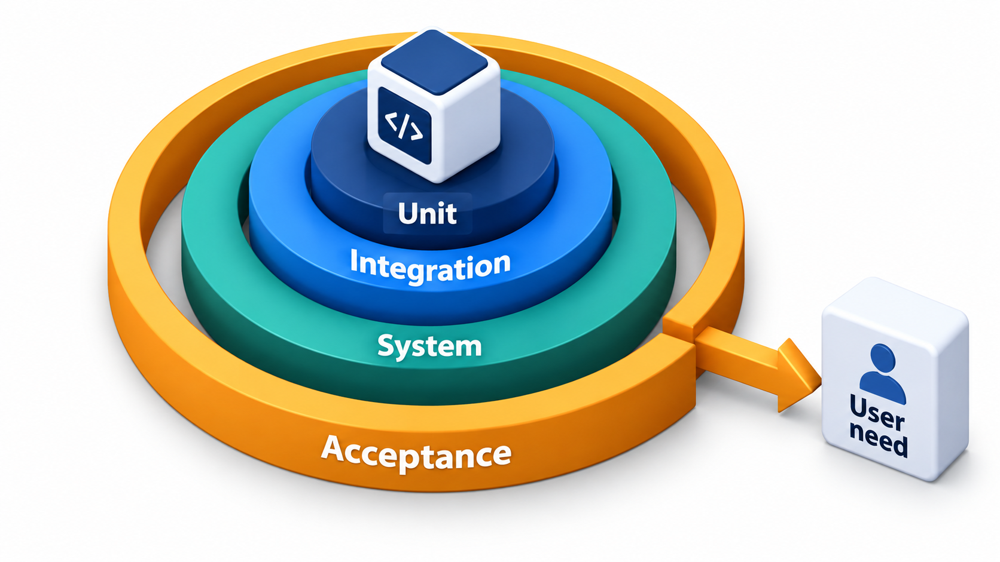
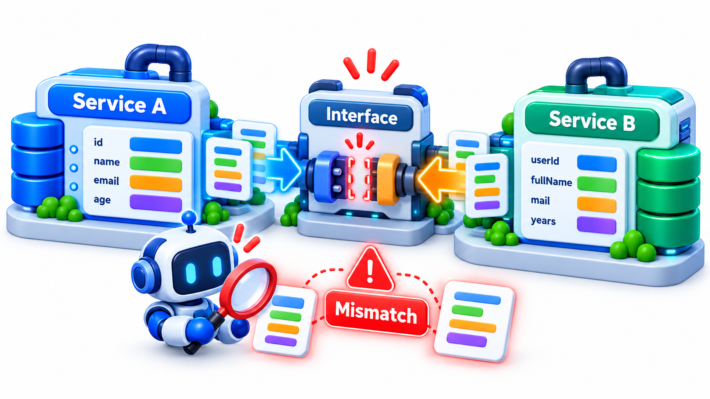
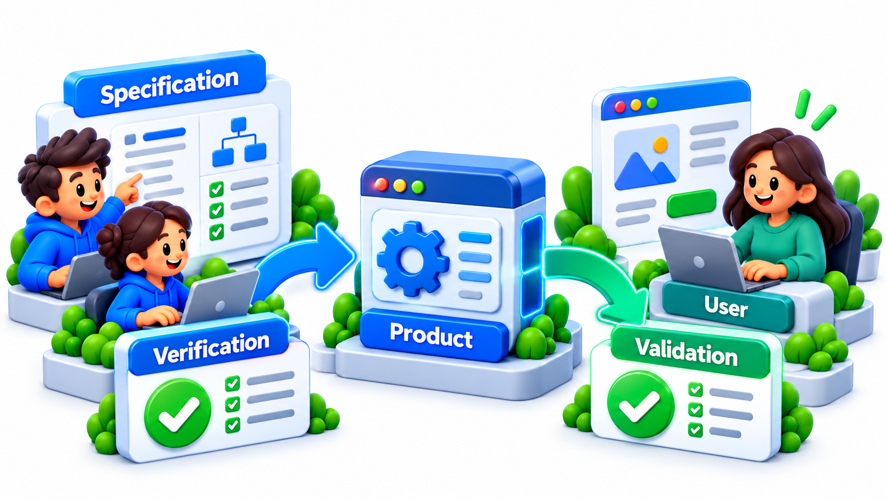
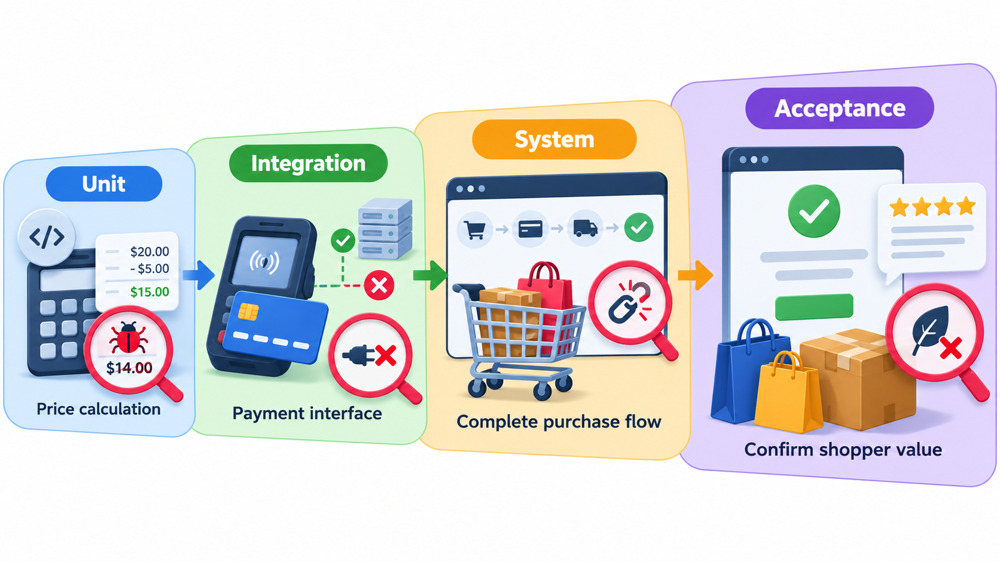
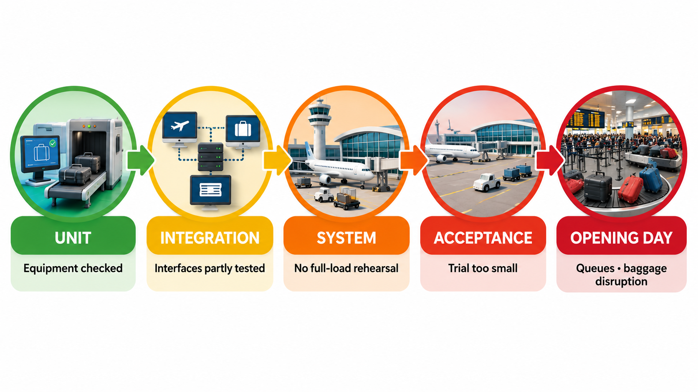

## Testing at Four Different Sizes

A system can be looked at as a single function, as a group of parts working together, as a complete product, or as a thing a customer uses. Each view answers a different question, and a problem that cannot be seen at one view shows up at the next. Testing is therefore organised into **levels**: unit, integration, system and acceptance.

A team that skips a level discovers the gap in public: a building whose parts worked alone but were never checked working together, under load, with the actual people who had to use them. This topic explains what each level checks and why each is needed.

## Four Levels

| Level | What is tested | Who usually does it | The question it asks |
| --- | --- | --- | --- |
| **Unit** | A single function, method or class in isolation | Developers | Does this piece do its job? |
| **Integration** | Several pieces working together; the connections between them | Developers and testers | Do the pieces fit together? |
| **System** | The complete, integrated product, against its requirements | Testers | Does the whole thing do what was specified? |
| **Acceptance** | The product in the eyes of the customer or user | Customers, users, product owners | Is this what we wanted, and can we use it? |

The levels grow in size: from a single function to a whole product in its real setting. They also change in what they look for. Unit tests find faults in logic. Integration tests find faults in interfaces: mismatched assumptions between parts. System tests find faults in overall behaviour and in qualities such as speed. Acceptance tests find the gap between what was built and what was needed.

<!-- Visual: four nested boxes from unit at the centre to acceptance at the outside, each labelled with its question. -->

## What Each Level Finds

The kinds of fault differ by level, which is a good reason to have all of them.

| Fault | Unit | Integration | System | Acceptance |
| --- | --- | --- | --- | --- |
| Wrong calculation in a function | Finds it | Might | Might | Rarely |
| Two modules disagree on units | Cannot | Finds it | Might | Might |
| Database query too slow under load | Cannot | Might | Finds it | Might |
| Feature works as specified but is not what the client meant | Cannot | Cannot | Cannot | Finds it |
| Whole system fails to start in production setting | Cannot | Might | Finds it | Finds it |
| Screen too confusing for clerks to use | Cannot | Cannot | Might | Finds it |

Reading across a row, a fault that one level cannot see is usually visible at another. Reading down a column, no level covers everything.

## Why Each Level Is Needed

Each level is a different way of looking, and it can miss what others see. The classic example is a fee module that calculates amounts in paise, one hundredth of a rupee, and a receipt module that expects rupees. Each one is correct on its own terms.

| Test | What it checks | Result |
| --- | --- | --- |
| Unit test of the fee module | 2 credits give 200,000 paise | Passes |
| Unit test of the receipt module | The amount 2,000 gives "Received Rs 2000" | Passes |
| Integration test | The fee module's answer is handed to the receipt module | The receipt says "Received Rs 200000" |

A team that stops at the unit level would conclude that the fee and the receipt both work. The integration test joins them: the receipt is handed 200,000 and the student is told they paid a hundred times more than they did. No unit test could have found this. Each function does what its own author intended. The fault lives in the *agreement between them* about units, which only a test that uses both can see.

<!-- Visual: integration testing exposing mismatched assumptions at a software interface. -->

## Moving Up the Levels

**Unit testing** is the foundation. It is cheap, fast and precise, and it gives developers the confidence to change code. It is usually written by the developer who wrote the code, or before it in test-driven development.

**Integration testing** joins components in groups and tests the interfaces. It looks at the data passed between them, the order of calls, error handling across the boundary, and the behaviour of real dependencies such as a database. It can be done in several orders: all at once, from the top down, or from the bottom up.

**System testing** exercises the complete product in an environment as close as possible to production, against the requirements. It covers the functional behaviour from end to end, and also the qualities that only appear in the whole: performance under load, security, compatibility with different devices, recovery after a failure. It is typically done by testers independent of the developers, who bring a fresh view.

**Acceptance testing** is the last level, where the customer or their representatives check whether the product is acceptable for use. Passing here means the product is ready to be accepted, signed off and released. It checks the system against the real need, which makes it a form of validation, while the levels below mainly verify against a specification.

<!-- Visual: verification checking the specification while validation checks the user's needs. -->

## A Feature Through All Four Levels

Follow "a student pays a fee and receives a receipt" up the levels.

| Level | A test | What it would catch |
| --- | --- | --- |
| **Unit** | The late-fine function returns 15 for 3 days late | A wrong rate or cap |
| **Integration** | Paying a fee saves a row in the real database and the receipt module reads it back | A column mismatch, a missing transaction |
| **System** | 500 students pay at the same time in a production-like setting; each gets one receipt | Slow responses, duplicate receipts, crashes under load |
| **Acceptance** | The accounts clerk pays a fee for a student using the real screens and agrees the receipt is acceptable for audit | A missing field on the receipt, a confusing flow |

Each test is small and specific to its level. Together they cover a feature from the inside out.

## Who Owns Which Level

Ownership affects how well a level is done. A level nobody owns is the level that is skipped.

| Level | Owner | Where the tests live | When they run |
| --- | --- | --- | --- |
| Unit | The developer who wrote the code | Beside the code | On every change, in seconds |
| Integration | Developers, sometimes with testers | In the repository, with their own set-up | On every merge, in minutes |
| System | The test team, or a quality engineer in each team | A test environment close to production | Nightly, or before each release |
| Acceptance | Product owner or customer representatives | Written as examples both sides understand | At the end of each increment and before release |

Teams that leave the integration level to "someone" often discover that nobody has run the parts together until the week of release. Naming an owner for each level, and a place where its tests run, prevents this.

## The Levels Meet the V-Model

The four levels are drawn in the V-model, a development model in which each stage of design on the way down is paired with a level of testing on the way up. Acceptance tests are planned from the business requirements, system tests from the system requirements, integration tests from the architecture and unit tests from the detailed design. In agile work the pairing survives even when the stages are short: each story has acceptance criteria, each component has its tests, and the levels run together in a build pipeline many times a day.

| Design stage (going down) | Test level (coming up) | Test planned from |
| --- | --- | --- |
| Business requirements | Acceptance | The customer's needs |
| System requirements | System | The specification of the whole |
| Architecture | Integration | The interfaces between parts |
| Detailed design | Unit | The behaviour of each piece |

## Where Teams Go Wrong

Common failures are skipping a level, doing it badly, or doing the wrong level for the fault. Teams with strong unit tests and no integration tests are surprised by interface bugs. Teams that rely entirely on system tests find problems late and cannot locate them. Teams that never involve real users until the end discover at acceptance that they built the wrong thing. The lesson is that each level should be done under conditions as real as it can be made, including the real people who will use the product.

<!-- Visual: a timeline of a new building's opening week showing the levels of testing that were thin: few realistic staff trials, no full-load baggage test, no complete rehearsal. Save as images/90_each_level_has_a_gap.png. -->

## Five Misreadings of Levels of Testing

**"Passing unit tests means the system works."** Units can each be right while the connections between them are wrong.

**"System testing makes the lower levels unnecessary."** A failure at system level is hard to trace. Lower levels find faults early and cheaply.

**"Acceptance testing is the testers' job."** It belongs to the customers and users, since only they can say whether the product meets their need.

**"The levels run in strict order, once."** In modern teams they run continuously, many times a day, and bugs at any level feed back immediately.

**"A trial in a test setting is as good as the real thing."** Tests that differ from reality in people, load or environment leave gaps where real failures hide.
