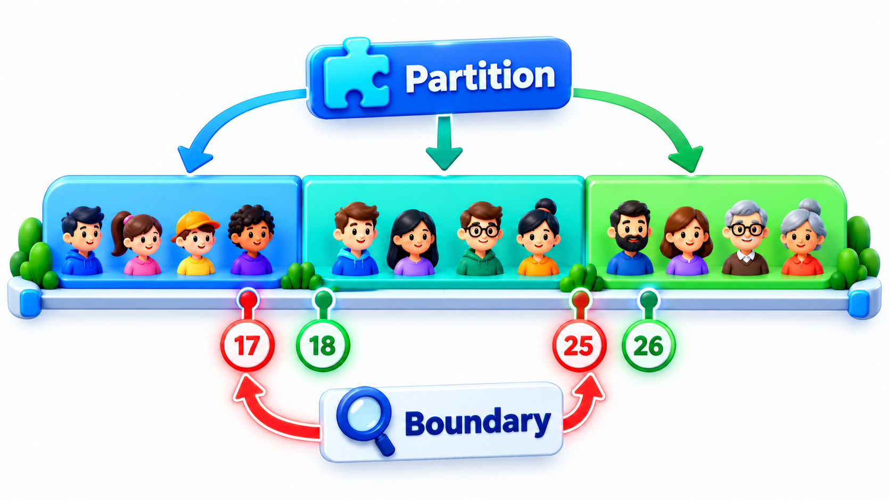
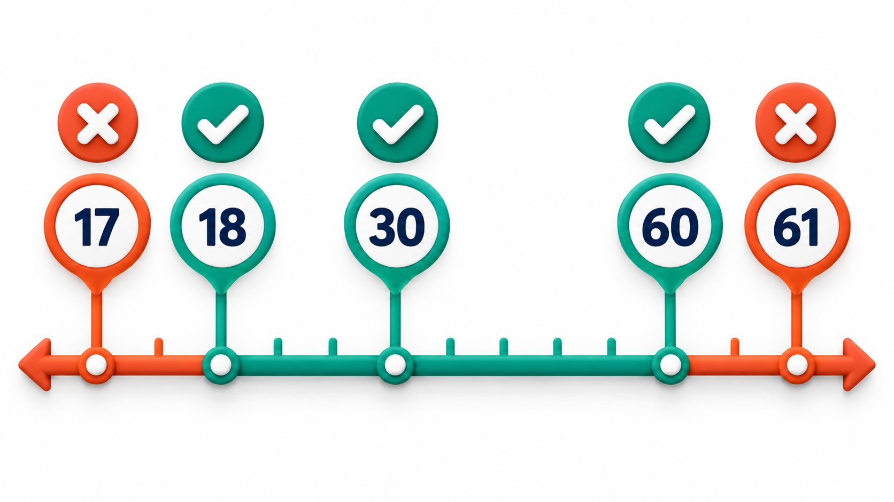
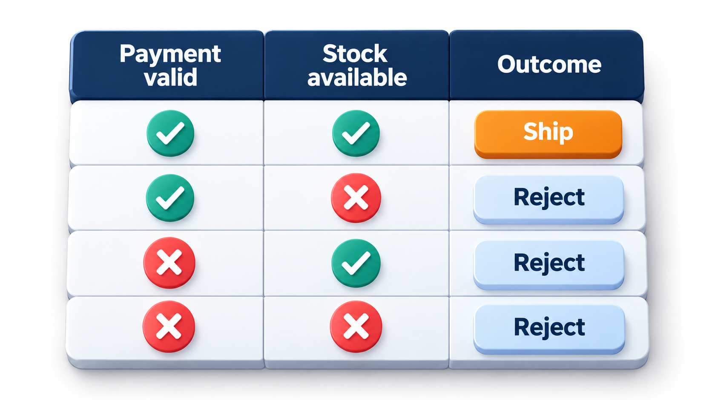
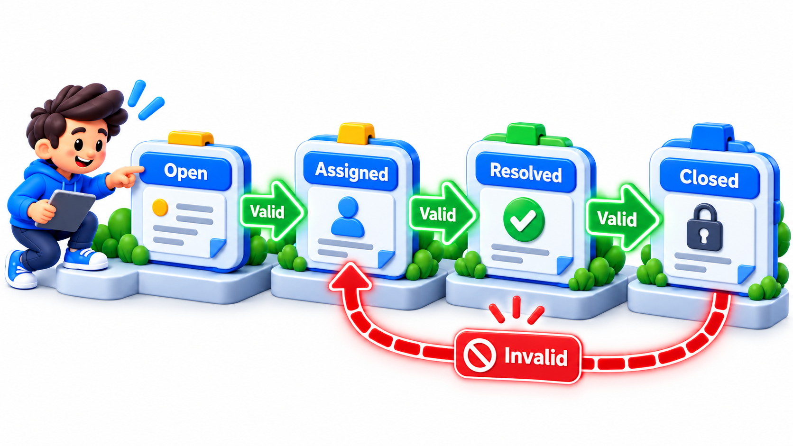
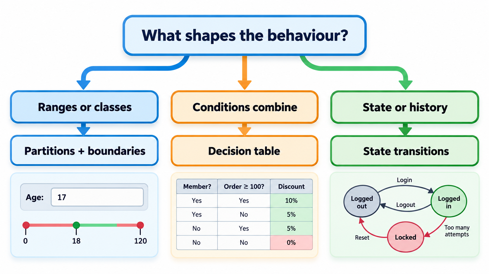

## Choosing Inputs When You Cannot Try Them All

A date routine works on every day but one: the last day of a leap year. A test on any ordinary date passes. The fault lives on a boundary, and finding such faults is the purpose of **black-box test design**, a set of methods for choosing test cases from the *specification* of a program, without looking at its code. The tester treats the program as a box with inputs and outputs. The techniques below choose the few inputs, out of countless possibilities, that are most likely to expose a fault: equivalence partitions, boundary values and decision tables.

The need for method is clear from the numbers. A form with a single age field that accepts whole numbers from 0 to 120 has 121 valid inputs. Add a second field with ten options and a third with five, and there are over 6,000 combinations. Add a few more fields and exhaustive testing is out of the question. Black-box techniques are ways to choose a small set that still finds most of the faults.

## Equivalence Partitioning

Most inputs are alike in how the program treats them. A ticket price that depends on age treats an 8-year-old and a 10-year-old the same way. Trying both adds little. **Equivalence partitioning** divides the input space into groups, called partitions, within which the program should behave the same, and tests one representative from each. If the program works for one member of a partition, the assumption is that it works for the rest.

For a ticket price with the rule "ages 0 to 4 free, 5 to 17 half price, 18 to 59 full price, 60 and over half price", the partitions are four ranges of valid ages, plus the invalid ones: negative numbers and non-numbers. One test from each is a small, complete set.

| Partition | Example member | Expected behaviour |
| --- | --- | --- |
| Valid: 0 to 4 | 2 | Free |
| Valid: 5 to 17 | 10 | Half price |
| Valid: 18 to 59 | 30 | Full price |
| Valid: 60 and over | 70 | Half price |
| Invalid: below 0 | -3 | Rejected with a message |
| Invalid: not a number | "abc" | Rejected with a message |
| Invalid: empty | (blank) | Rejected, or a documented default |

Seven tests stand in for thousands of possible inputs. The invalid partitions are as important as the valid ones: many real failures come from unexpected input.

## Boundary Value Analysis

Experience shows that faults gather at the edges of partitions, where a "less than" should have been "less than or equal", or a count is off by one. **Boundary value analysis** adds tests at each edge: the last value inside a partition, the first value outside, and sometimes the edge itself. Take a ticket rule: ages 0 to 4 free, 5 to 17 half price, 18 to 59 full price, 60 and over half price. The boundaries are 4 and 5, 17 and 18, 59 and 60.

| Kind of test | Ages tried | Expected price |
| --- | --- | --- |
| One per partition | 2, 10, 30, 70 | 0, 50, 100, 50 |
| Around the first boundary | 4, 5 | 0, 50 |
| Around the second boundary | 17, 18 | 50, 100 |
| Around the third boundary | 59, 60 | 100, 50 |

Ten cases cover a range of 120 possible ages, selected by method, so they are far more likely to catch an error than ten random ages. Had the rule been built with "age at most 5" instead of "age below 5", the partition tests would still pass. Only the boundary tests at 4 and 5 would reveal the fault. That is why they are included.

A mutation of the rule shows the point. Suppose the developer wrote the first boundary as "age less than or equal to 5 is free" by mistake.

| Age | Specified price | Program's price | Caught by partition tests (2, 10, 30, 70)? | Caught by boundary tests (4, 5)? |
| --- | --- | --- | --- | --- |
| 2 | 0 | 0 | Passes | Not relevant |
| 4 | 0 | 0 | Not tried | Passes |
| 5 | 50 | 0 | Not tried | **Fails: found** |
| 10 | 50 | 50 | Passes | Not relevant |

The partition tests all pass. Only age 5 exposes the fault.

For numeric ranges, a common checklist tests the minimum, one above the minimum, a typical value, one below the maximum and the maximum, plus one just outside each end. For a field accepting 1 to 100: 0, 1, 2, 50, 99, 100, 101.

<!-- Visual: equivalence partitions reducing the number of cases while boundary tests probe the edges. -->

## Decision Tables

When behaviour depends on a combination of conditions, partitions and boundaries are not enough. A loan might be approved depending on whether the applicant has a job and whether their credit history is good. A **decision table** lists every combination of the conditions and states the expected action for each. With *n* yes-or-no conditions there are 2n rows. Writing them out forces the specification to say what should happen in each case, including the ones the author forgot, and each row becomes a test.

<!-- Visual: boundary tests probing just below, at and just above valid limits. -->

| Has a job | Good credit history | Expected action |
| --- | --- | --- |
| Yes | Yes | Approve |
| Yes | No | Manual review |
| No | Yes | Manual review |
| No | No | Reject |

Two conditions need four rows. If a row had been left out of the specification, the tester would notice an empty row while drawing the table, and ask what should happen. That question is the main value of the method. For three conditions there are eight rows, for five conditions thirty-two. When the table becomes too big, testers group conditions or use pairwise techniques, which choose a subset of combinations that covers every pair.

| Conditions | Full table rows | Pairwise tests (approximate) |
| --- | --- | --- |
| 3 yes/no | 8 | 4 |
| 5 yes/no | 32 | 6 |
| 10 yes/no | 1,024 | 9 to 10 |
| 4 fields with 3 options each | 81 | 9 |

Pairwise testing rests on the observation that most faults are triggered by one or two conditions, rarely by many together, so covering every pair finds most of them with far fewer tests.

<!-- Visual: each decision-table rule becoming a focused test case. -->

## A Larger Decision Table

A realistic example: a hostel fee waiver depends on three conditions.

| Scholarship | Family income below limit | Attendance above 75% | Waiver |
| --- | --- | --- | --- |
| Yes | Yes | Yes | 100% |
| Yes | Yes | No | 50% |
| Yes | No | Yes | 50% |
| Yes | No | No | None |
| No | Yes | Yes | 50% |
| No | Yes | No | None |
| No | No | Yes | None |
| No | No | No | None |

Eight rows and eight tests. Drawing the table might reveal that the specification never said what happens for a scholarship holder with low attendance but high income. Each such gap is a question for the product owner, found before a line of code is written.

## State-Transition Testing

Some systems behave according to their history: an order that is placed, paid, shipped and delivered, or a login that locks after three wrong passwords. **State-transition testing** models the system as states and the events that move it between them, and designs tests to cover each transition. A good set also includes tests for *forbidden* transitions, such as trying to cancel an order that has shipped, to check that the system refuses them. The test cases come from the state diagram itself: one for each arrow, and one for each missing arrow.

Take the login lock: three wrong passwords lock the account.

| Test | Starting state | Event | Expected next state |
| --- | --- | --- | --- |
| 1 | Active, 0 failures | Correct password | Active, 0 failures |
| 2 | Active, 0 failures | Wrong password | Active, 1 failure |
| 3 | Active, 2 failures | Wrong password | Locked |
| 4 | Active, 2 failures | Correct password | Active, 0 failures (counter reset) |
| 5 | Locked | Correct password | Still locked (forbidden transition) |
| 6 | Locked | Wait 30 minutes, then correct password | Active |

The fifth test is the forbidden transition, and it is the easiest to forget.

<!-- Visual: state-based tests probing both allowed and forbidden transitions. -->

## Other Black-Box Ideas

| Idea | What it does | Example |
| --- | --- | --- |
| **Error guessing** | Uses experience to guess where faults hide | Trying a name with an apostrophe, an empty file, a very long string |
| **Exploratory testing** | Learns and tests at the same time, without a script | A tester explores a new screen and follows what looks odd |
| **Use-case testing** | Walks through user scenarios from start to end | Student logs in, pays, downloads receipt |
| **Cause-effect graphs** | Maps causes to effects for complex logic | Used in specification-heavy domains |

Error guessing sounds unscientific but is valuable: experienced testers carry a mental list of troublemakers (zero, negative numbers, empty values, very large values, special characters, dates around month ends and leap days).

## Choosing Among the Techniques

| Technique | Best for | Finds |
| --- | --- | --- |
| **Equivalence partitioning** | Inputs falling into ranges or categories | Gross errors in handling a whole class of input |
| **Boundary value analysis** | The edges of those ranges | Off-by-one and comparison errors |
| **Decision tables** | Rules combining several conditions | Missing or wrong combinations |
| **State-transition testing** | Behaviour depending on history | Wrong or missing transitions |

They are not rivals. A real function often needs two or three together: partitions and boundaries for the numbers it takes, a decision table for its rules. All of them are independent of the code, so the tests can be designed from the specification before the code exists, and they check the program against what it should do, not against what it happens to do.

<!-- Visual: a flow chart helping a tester choose a technique: input is a range -> partitions and boundaries; several conditions combine -> decision table; depends on history -> state transitions. Save as images/91_choose_a_technique.png. -->

## Five Misreadings of Black-Box Testing

**"Black-box means random testing."** It is the most deliberate kind: cases chosen by method from the specification.

**"Testing one value per partition is enough."** It is enough for the middle of the partition. The edges are where faults cluster, so they need their own tests.

**"We can skip the table; the code is simple."** Simple code can still miss a combination. Writing the table finds gaps in the specification, not just the code.

**"Black-box tests make code coverage unnecessary."** They test behaviour from outside, and coverage shows what code was never run. The two views complement each other.

**"A bug that fails only one day in four years is too rare to be found."** One test finds it: the last day of a leap year. Boundaries are where to look.
