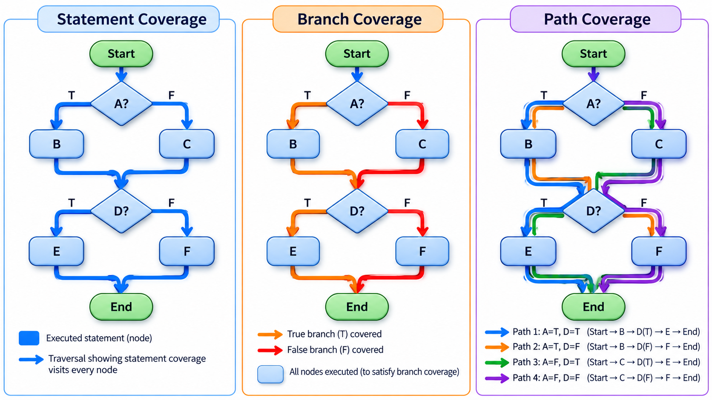
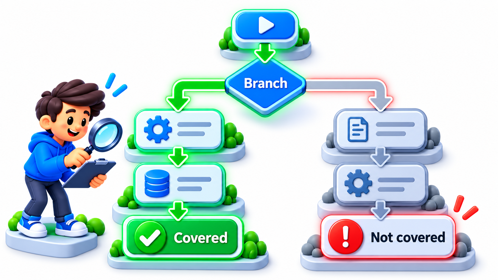
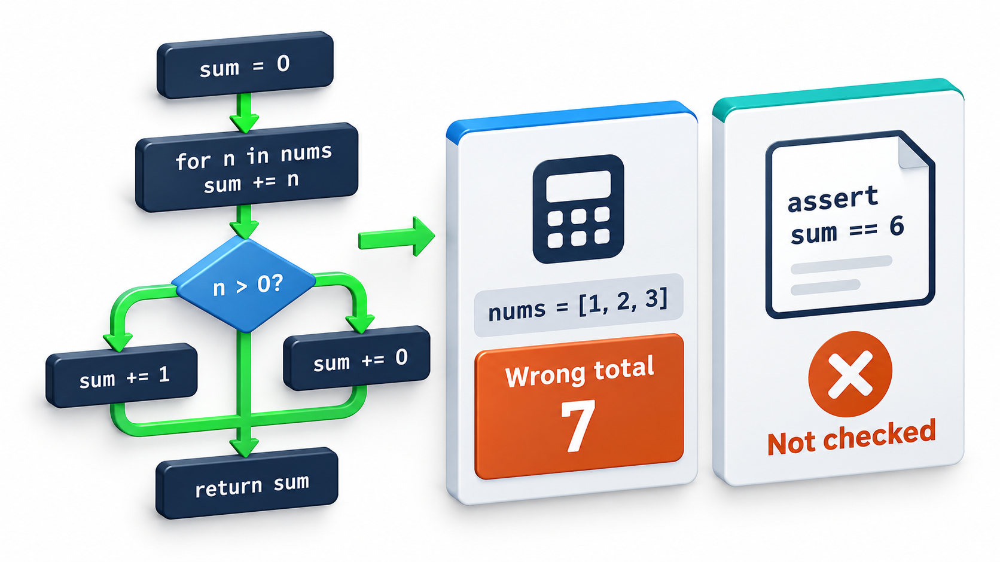
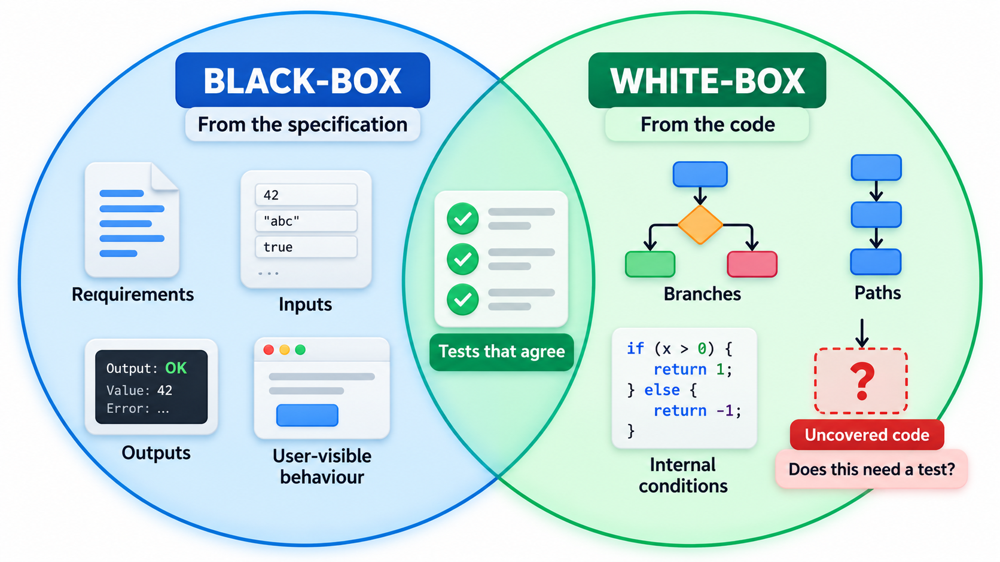

## Testing by Looking Inside

Black-box testing asks "what should the program do?". **White-box testing**, also called structural testing, asks a different question: "have we exercised what the program actually contains?". It designs tests by looking at the code. Where a program has a decision, a good set of tests should make it go both ways; where it has a block, some test should reach it.

The measure of how much of the code the tests reach is **coverage**. Some of the most heavily relied-on software in the world is tested to full branch coverage, as a way of finding the parts of the code that no test has ever touched. But coverage is a useful tool for finding gaps and a poor measure of how good a test suite is, and this topic covers both halves of that message.

The two views are complementary because they start from different places. A specification describes what ought to exist. The code describes what does. Faults hide in the difference: behaviour that was specified but never built, and code that was built but never specified.

## What Coverage Measures

**Coverage** is the share of some part of the code that a set of tests has executed. Different definitions of "part" give different levels of strictness.

| Measure | What must be executed | Strength |
| --- | --- | --- |
| **Statement coverage** | Every line of code | The weakest. A line can run without being tested properly |
| **Branch (decision) coverage** | Every `if` has gone both ways, true and false | The usual standard; finds untested alternatives |
| **Condition coverage** | Every part of a compound condition (`a and b`) has been true and false | Finds problems hidden inside combined conditions |
| **Path coverage** | Every possible route through the function | The strongest, and usually impossible because the number of paths grows explosively |

Statement coverage can be misleading. In a rule that sets y to 1 only when x is positive, a single test with x equal to 5 runs every statement and still never tests what happens when x is not positive. Branch coverage demands a second test with x at zero or below. For loops, paths multiply: a function with ten independent `if` statements has 1,024 paths.

A practical compromise for complex functions is **basis path testing**. It uses the cyclomatic complexity of a function (the number of decisions plus one) as the number of independent paths to cover, giving a manageable set of tests that between them exercise every decision.

## The Same Code at Three Coverage Levels

Take a rule: a student is eligible if marks are at least 40 and attendance is at least 75. Written as one condition that joins the two tests with "and".

| Test set | Tests | Statement coverage | Branch coverage | Condition coverage |
| --- | --- | --- | --- | --- |
| A | (50, 80) only | 100% (the line runs) | 50% (only the true branch) | 50% (each condition only true) |
| B | (50, 80) and (30, 80) | 100% | 100% (both outcomes) | 75% (attendance never false) |
| C | (50, 80), (30, 80), (50, 60) | 100% | 100% | 100% (marks and attendance each true and false) |

Set A looks complete under statement coverage and has tested one case out of four. Set C covers each condition both ways. The ladder shows why statement coverage is the weakest figure to quote.

## Measuring Branch Coverage

Real tools instrument the code and report coverage automatically; here the idea is made visible by hand. A function classifies a student's result and has four possible outcomes: distinction (75 or more), pass with attendance, pass without attendance (a warning), and fail.

| Test set | Tests | Branches reached | Never run |
| --- | --- | --- | --- |
| Two tests | 80 marks with attendance; 60 marks with attendance | 2 of 4: distinction and pass-attended | Pass-absent (a warning) and fail |
| Four tests | The same two, plus 55 marks without attendance, and 20 marks | 4 of 4 | Nothing |

The first set reaches two branches, so branch coverage is 50 per cent. The report is the useful part. It does not just say "50 per cent". It names the cases no test has tried, and the tester can write exactly those. Adding a student with 55 marks who did not attend and one with 20 marks brings all four branches into play.

<!-- Visual: coverage revealing which control-flow paths tests have not exercised. -->

## Reading a Coverage Report

A report lists coverage per file and highlights lines never executed. How to use it:

| Finding | Question to ask | Likely action |
| --- | --- | --- |
| Error-handling branch never run | Can this failure really happen? | Add a test that triggers it |
| A whole function never called | Is it dead code? | Delete it, or test it |
| A branch only reached in production | Is there a case we missed in the spec? | Add a test from the real scenario |
| Logging or trivial getter uncovered | Does it matter? | Usually no; leave it |
| Complex rule at 40% | Is it risky? | Raise it with targeted tests |

The question to ask of each gap is not "how do I raise the number" but "what could go wrong here, and would we notice?".

## What Coverage Does Not Tell You

A high coverage figure is easy to read as a statement about quality, and it is not one. Coverage says what code was *executed* by the tests. It says nothing about whether the tests *checked* anything.

- A test that calls a function and asserts nothing gives full coverage and no protection.
- Coverage cannot see code that is missing. If the program forgot to handle an empty list, there is no line to cover.
- A line can be covered by a test with the wrong expected value, and the test passes.
- It measures the quantity of code run and not the quality of the inputs: a boundary bug is not caught if the tests only use the middle values.

<!-- Visual: executing every path does not prove the result is correct. -->

Treat coverage as a one-way signal. Low coverage proves that something is untested. High coverage proves only that nothing is *obviously* untested. A sensible use is to look at the uncovered lines, ask for each whether a test is needed, and not to chase a number. Targets such as "80 per cent" are common, but a target turned into a rule invites tests written to raise the figure.

## Checking the Tests Themselves

A way to measure whether tests really check something is **mutation testing**. A tool makes small deliberate changes to the code, called mutants, such as changing "at least" to "more than" or a plus to a minus, and reruns the tests. If a test fails, the mutant is "killed", which is good: the tests noticed the change. If all tests still pass, the mutant "survived", which means that no test cares about that behaviour. The share of mutants killed is the mutation score, and it is a much more honest measure of test strength than coverage.

| Mutant | Change | Tests fail? | Meaning |
| --- | --- | --- | --- |
| 1 | "marks at least 40" becomes "marks more than 40" | Yes (the boundary test at 40 fails) | Killed: good |
| 2 | "attendance at least 75" becomes "attendance at least 7" | No | Survived: no test checks attendance near 75 |
| 3 | `and` becomes `or` | Yes | Killed |
| 4 | Remove the line that records the result | No | Survived: no test checks the result is recorded |

Two of four survive, so the mutation score is 50 per cent, even if line coverage was 100. The survivors point to exactly the tests to write.

<!-- Visual: mutation testing checking whether the tests detect deliberate defects. -->

## Using White-Box and Black-Box Together

The two approaches find different faults. Black-box tests, designed from the specification, find missing and wrong behaviour, including code that does not exist yet. White-box analysis finds code that the black-box tests never reached: dead code, forgotten branches, unhandled error paths. The usual practice is to design tests from the requirements first, run them under a coverage tool, and then look at what was missed, adding tests for the gaps that matter.

| Fault | Black-box finds it? | White-box finds it? |
| --- | --- | --- |
| Requirement not implemented | Yes | No: there is no code to cover |
| Wrong boundary in a comparison | Yes, with boundary tests | Only if a test chooses the value |
| Dead code left behind | No | Yes: shows as uncovered |
| Error-handling branch never exercised | Maybe | Yes: shows as uncovered |
| Wrong output for a covered line | Yes | No: coverage does not check results |

<!-- Visual: two circles overlapping: black-box tests (from the specification) and white-box analysis (from the code), with the overlap labelled "tests that agree" and the uncovered code labelled "ask: does this need a test?". Save as images/92_black_and_white_box.png. -->

## Five Misreadings of Coverage

**"One hundred per cent coverage means no bugs."** It means every line ran. Tests may check nothing, and missing code cannot be covered.

**"Low coverage is always a problem."** It marks code that is untested. Whether that matters depends on how risky the code is.

**"Coverage targets raise quality."** They raise the number. Without attention to the strength of tests, they encourage weak tests that run code without checking it.

**"Path coverage is the gold standard."** It is the strongest in theory and impossible in practice. Branch coverage with good test design is the working standard.

**"White-box testing replaces black-box."** They find different faults. Use both.
