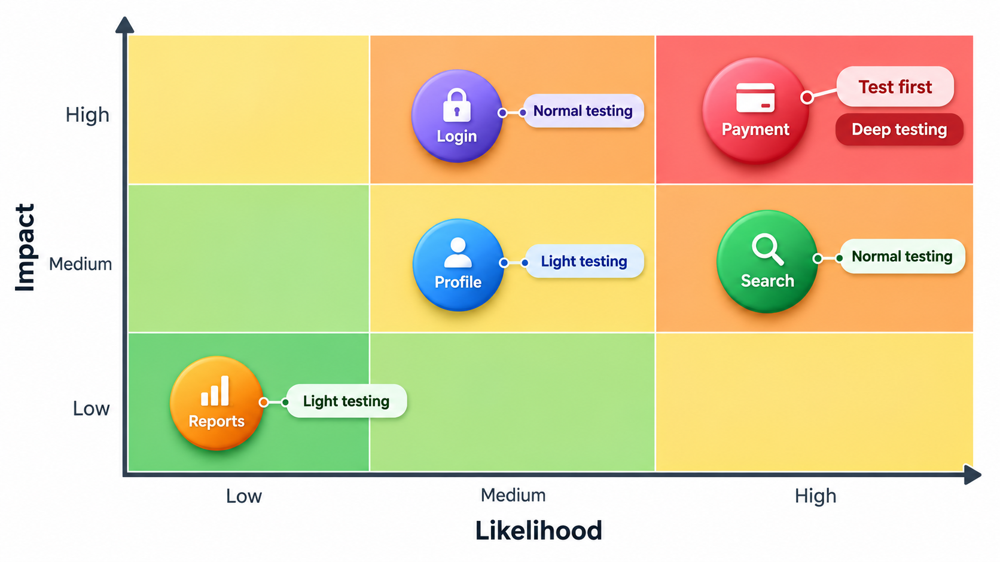
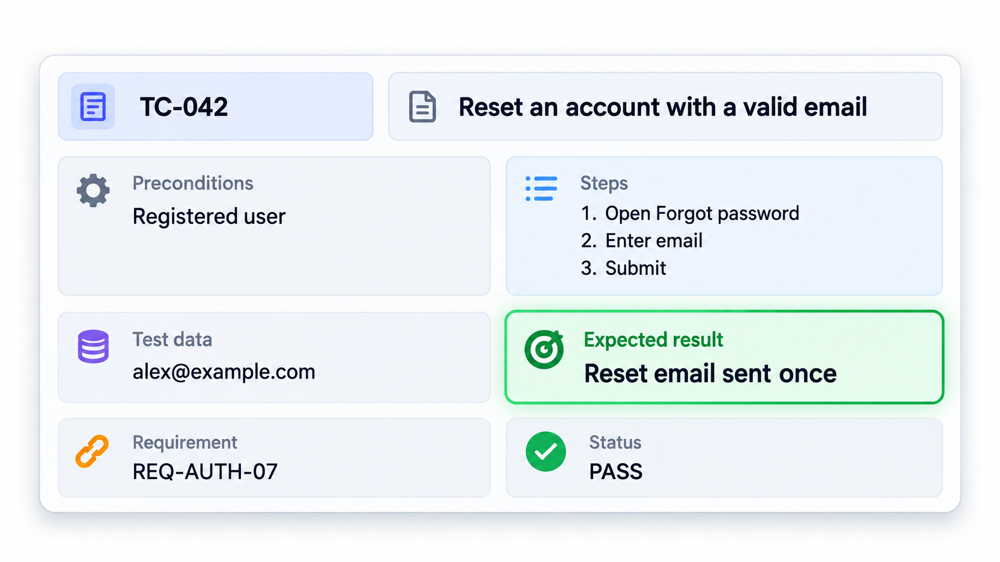
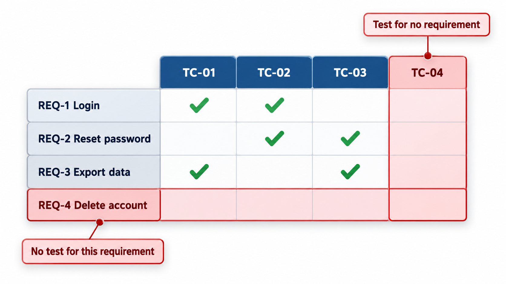
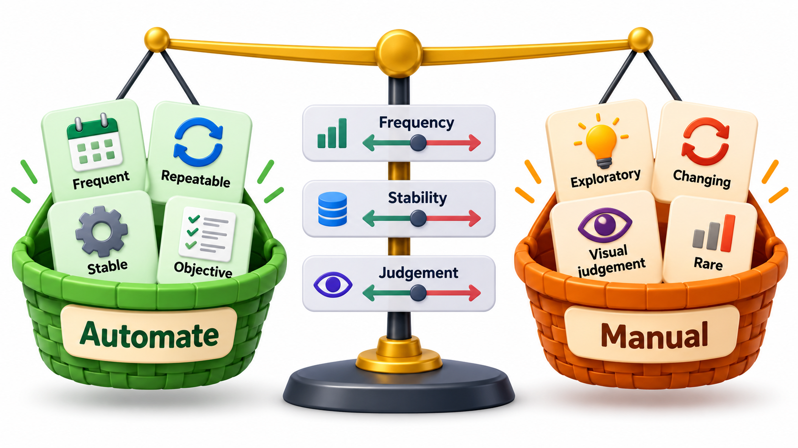
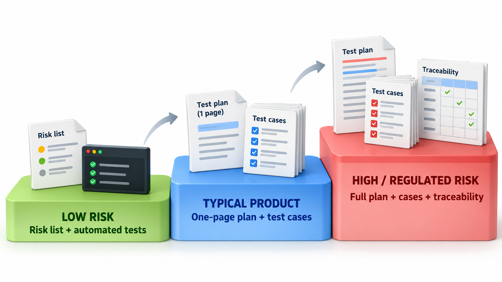

## How Much Planning Is Enough?

Testing needs to be planned: what will be tested, by whom, with what, by when. It also needs to be recorded, so that the same tests can be repeated and the results checked. But the paper can grow without limit. There is a long-running disagreement about how much is enough: on one side, the need to *plan and record*, so that testing is organised, repeatable and accountable, especially in regulated industries; on the other, the danger of *too much ceremony*, so that the effort goes into writing and not testing.

This topic covers the working parts, the test plan and the test case, with an eye on how much of each is enough.

The disagreement is real even among experts. An international standard for software test documentation, ISO/IEC/IEEE 29119, was challenged by a group of testers who argued that a single prescribed process cannot suit every kind of project. Both sides are right in their own settings, and the sensible response is to size the paperwork to the risk.

## The Test Plan

A **test plan** says how testing will be done for a project or a release. It answers a set of questions in advance.

| Section | The question it answers |
| --- | --- |
| **Scope** | What will be tested, and what will not? |
| **Approach** | Which levels and techniques will be used? |
| **Risks** | What are the likeliest and costliest failures? Where will effort go? |
| **Environment** | What machines, data and tools are needed? |
| **Schedule and people** | Who does what, and by when? |
| **Entry and exit criteria** | What must be true to start testing, and to declare it finished? |
| **Reporting** | How will progress and defects be reported? |

Exit criteria deserve a note. "Testing is finished" is a decision and not a fact, because testing can never prove the absence of defects. A plan states in advance what will count as enough: for example, all high-priority tests run, no open critical defects, and branch coverage of the payment module above 90 per cent.

A plan can be a single page. The IEEE 829 template was often filled with pages of text nobody read. The useful version states the decisions that matter, particularly scope and risk.

| Criterion | Entry (to start system testing) | Exit (to declare it done) |
| --- | --- | --- |
| Build | Passes the smoke tests | Release candidate frozen |
| Tests | Test cases reviewed and ready | All high-priority cases run; 95% of all |
| Defects | No open blocker | No open critical or high defect; known minor ones listed |
| Environment | Test environment mirrors production | Final run on that environment |
| Coverage | Unit tests meet team target | Payment module branch coverage above 90% |

## Putting Effort Where the Risk Is

Time is limited and everything cannot be tested equally. **Risk-based testing** allocates effort in proportion to risk: the chance that a feature has a defect, multiplied by the damage a failure would do. Take four features and 40 hours of testing time. Damage is scored from 1 to 10.

| Feature | Chance of a defect | Damage | Risk score | Test hours (share of 40) |
| --- | --- | --- | --- | --- |
| Fee payment | 0.3 | 9 | 2.7 | 23.0 |
| Receipt | 0.2 | 4 | 0.8 | 6.8 |
| Login | 0.1 | 8 | 0.8 | 6.8 |
| Report colours | 0.4 | 1 | 0.4 | 3.4 |

Each feature's share of the 40 hours is its score divided by the total of all scores, 4.7. Fee payment receives 23 hours, over half. The result may differ from instinct: the most defect-prone feature, report colours at 40 per cent, gets the least time because failure there is harmless. Money gets the most. The scores are estimates, and the value of the exercise is that the team has to argue about them. Changing a score shows at once how the plan shifts.

## Estimating Chance and Damage

The two inputs to a risk score are judgements, and a few questions make them less arbitrary.

| Factor | Raises the chance of a defect | Raises the damage |
| --- | --- | --- |
| **Newness** | New code, new technology | |
| **Complexity** | Many rules and interactions | |
| **Change** | Recently or frequently modified | |
| **History** | Past bugs in the area | |
| **Money or safety** | | Payments, health, personal data |
| **Users** | | Many users, or critical ones |
| **Reversibility** | | Errors cannot be undone |
| **Visibility** | | Failures would be public |

## The Test Case

A **test case** is a single, specific check, written down so that anyone can run it and get the same result. The fields are few.

| Field | Content | Example |
| --- | --- | --- |
| **ID** | A unique reference | TC-FEE-014 |
| **Title** | What it checks, in a line | Late fine is capped at 100 rupees |
| **Preconditions** | The state needed before starting | Student with a fee due 40 days ago |
| **Steps** | What to do | Open fee page; select the student; click "Calculate fine" |
| **Test data** | The inputs | Roll number 1042; date 40 days after the due date |
| **Expected result** | What should happen | Fine shown as 100 |
| **Actual result and status** | Recorded when run | Pass or fail, with notes |
| **Requirement link** | Which requirement it checks | REQ-FEE-6 |

The most important field is the expected result. A test with no stated expectation cannot fail. A test case is good if it is **clear** (another person can run it), **focused** (checks one thing, so a failure points to a cause), **repeatable** (the same steps give the same outcome) and **traceable** (linked to a requirement).

<!-- Visual: a test case card with its fields laid out: ID, title, preconditions, numbered steps, test data, expected result, status and requirement link, with the expected result highlighted. Save as images/93_test_case_card.png. -->

## Good and Poor Test Cases

| Aspect | Poor | Good |
| --- | --- | --- |
| Title | "Test fees" | "Late fine is capped at 100 rupees" |
| Steps | "Check the fine works" | Numbered, specific actions |
| Data | "Some student" | Roll 1042, due date 40 days ago |
| Expected result | "It should be right" | "Fine shown as 100" |
| Scope | Ten checks in one case | One check per case |
| Independence | Needs another case to run first | Sets up its own state |

## Traceability

The requirement link connects tests to the reasons they exist. A **traceability matrix** is a table of requirements against test cases. It answers two questions: does every requirement have at least one test (is anything uncovered?), and does every test belong to some requirement (is anything pointless?). When a requirement changes, the matrix lists the tests that need review. When a test fails, it shows which requirement is in doubt. In regulated work, the matrix is evidence that nothing was forgotten.

| Requirement | TC-FEE-014 | TC-FEE-015 | TC-LOG-003 |
| --- | --- | --- | --- |
| REQ-FEE-6: fine capped at 100 | X | | |
| REQ-FEE-7: fine waived for scholarship | | X | |
| REQ-LOG-2: lock after 3 failures | | | X |
| REQ-LOG-3: unlock after 30 minutes | | | |

The last row is empty, so a requirement has no test. That gap is what the matrix is for.

<!-- Visual: a grid with requirements as rows and test cases as columns, filled cells showing coverage, one empty row marked "no test for this requirement" and one empty column marked "test for no requirement". Save as images/93_traceability_grid.png. -->

## Manual and Automated Tests

A test case written in prose is for a person to run. The same case can be turned into code that runs by itself. Automation pays when a test will be run many times, as with regression tests, and when it is stable and well-defined. Manual testing pays when a test will be run once or twice, when it needs human judgement (does this look right?), and in exploration of new behaviour. The plan should say which is which.

| Test | Run how often | Needs judgement? | Better as |
| --- | --- | --- | --- |
| Fine calculation | Every build | No | Automated |
| Login lock | Every build | No | Automated |
| New report layout looks readable | Once | Yes | Manual |
| Exploring a new screen | Once per release | Yes | Manual (exploratory) |
| Payment end-to-end | Every release | No, but fragile to automate | Automated, a few critical paths |

## Right-Sizing the Paperwork

The test documents are a means to an end. For a regulated medical device, detailed records may be required by law. For a start-up's mobile app, a short risk list and a set of automated tests may be all that is useful. A good question for any document is who will read it and what decision it supports. If nobody will, do not write it.

<!-- Visual: a scale from "a risk list and automated tests" through "a one-page test plan and a spreadsheet of cases" to "a full plan, cases and traceability matrix", labelled with the kind of project each suits. Save as images/93_paperwork_scale.png. -->

