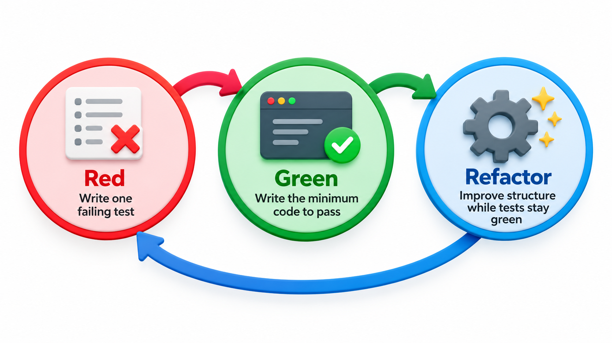
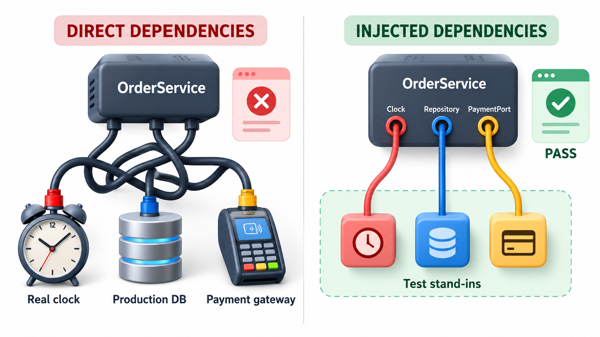

## The Smallest Test That Can Fail

A unit test checks one small piece of code, usually a single function, in isolation, fast enough to run thousands of times a day. Before such tests existed in a standard form, testing meant running the program by hand and looking at the output. Once a family of testing frameworks appeared, sharing one design, it meant a program that checks other programs, every few seconds, for free. That design is known as **xUnit**.

Its structure is a class of test methods, each checking one thing, run automatically with a report of what passed and failed. This topic is about the **unit test** at the base of the pyramid: what makes a good one, how it is written, and how it is organised.

## What a Unit Test Is

A unit test checks one small piece of code, a function or a method, in isolation from the rest of the system. It supplies an input, runs the code and compares the result with an expected value. It runs in milliseconds without a database, a network or a file. Because it is small and fast, thousands can run in seconds, after every change, and when one fails the cause is within a few lines.

The benefits go beyond finding bugs. A set of unit tests lets developers change code with confidence, because a mistake shows up at once. The tests also document the code: each shows an example of how it is meant to be used and what it should return. They encourage a design with small, separate pieces, since code that is hard to test is usually code that does too much.

| Benefit | How the unit tests deliver it |
| --- | --- |
| **Early bug detection** | A mistake is caught seconds after it is made, while the change is fresh in mind |
| **Safe change** | Refactoring and new features can be tried, with the tests as a safety net |
| **Living documentation** | Each test shows a real example of use and the expected result |
| **Design pressure** | Hard-to-test code reveals tangled responsibilities |
| **Quick diagnosis** | A failure points at one function, not at the whole system |

## Arrange, Act, Assert

A readable unit test follows a three-part shape, often called **Arrange, Act, Assert**.

1. **Arrange.** Set up what the test needs: create objects, choose inputs.
2. **Act.** Call the code being tested, once.
3. **Assert.** Check that the result is what was expected.

Keeping the parts separate makes a test easy to read, and one act per test means one reason to fail. A test that does many things and has many assertions makes the cause of a failure hard to see.

<!-- Visual: arrange, act and assert giving a unit test a clear structure. -->

## An xUnit Test in Practice

Consider a late-fine rule: 5 rupees a day, never below zero days, capped at 100. A test class checks it with three tests. It also has a **fixture**, a setup step that runs fresh before every test to provide the starting conditions, so tests cannot affect each other. The framework finds every test, runs it and reports how many passed.

| Test | Arrange / Act / Assert |
| --- | --- |
| On time has no fine | A fine for 0 days late should be 0 |
| Three days late | A fine for 3 days late should be 3 days x the rate of 5, which is 15 |
| Fine is capped at 100 | A fine for 500 days late should be 100 |

When the framework runs them, the summary shows that three tests ran with no failures and no errors. Each test follows Arrange, Act, Assert in a line or two, checks one idea, and has a name that says what is being checked. If someone changed the cap to 200, the third test would fail and the count would show one failure.

A framework distinguishes three outcomes, and the difference matters when reading a report.

| Outcome | Meaning | Typical cause |
| --- | --- | --- |
| **Pass** | The assertion held | Code behaves as expected |
| **Failure** | An assertion was false | The code gave a wrong answer |
| **Error** | The test could not finish | An unexpected exception, a bad set-up, a typo in the test |

A failure points at the code under test. An error often points at the test or its set-up.

## Qualities of a Good Unit Test

Experienced developers summarise a good unit test as **fast, isolated, repeatable, self-checking and clear**.

- **Fast.** Milliseconds, so that running all of them is no burden.
- **Isolated.** It does not depend on other tests or on the order of running. It uses no real database, network or clock.
- **Repeatable.** The same result every time, on any machine.
- **Self-checking.** The test decides pass or fail itself. No one needs to read output and judge.
- **Clear.** The name and body say what is expected, and a failure message points at the cause.

<!-- Visual: good unit tests being fast, isolated, repeatable and clear. -->

## Smells in Test Code

Tests are code, and they have smells of their own.

| Smell | What it looks like | Why it hurts | Remedy |
| --- | --- | --- | --- |
| **Fragile test** | Breaks whenever internals change | False alarms; people stop trusting the suite | Test behaviour, not steps |
| **Flaky test** | Sometimes passes, sometimes fails | Wastes time; hides real failures | Remove dependence on time, order and network |
| **Slow test** | Seconds each | Suite is not run often | Replace external parts with doubles |
| **Obscure test** | Cannot tell what is checked | Failures are puzzling | Better names; Arrange, Act, Assert |
| **Test with logic** | Contains loops and conditions | The test itself may be wrong | Keep tests plain; write several tests |
| **Shared state** | Tests affect each other | Results depend on order | Fresh fixture per test |
| **No assertion** | Calls code and checks nothing | Gives false confidence | Always assert an outcome |

## Naming and Organising Tests

A test name should read like a sentence about behaviour: `test_on_time_has_no_fine`, `test_fine_is_capped_at_100`. When it fails in a report, the name alone should say what broke. Group tests by the unit they exercise, one test file per module is a common habit. Put the common setup in fixtures. Test the behaviour and not the internal steps, so that a refactoring that keeps behaviour does not break tests.

Which cases to write comes from the black-box and white-box techniques: a normal case, the boundaries, the error cases and the empty or zero case. For `late_fine`, the cases are zero days, one day, the day before the cap, the cap itself, a negative number and a huge number.

| Case | Input (days late) | Expected fine | Why it is included |
| --- | --- | --- | --- |
| Zero | 0 | 0 | Lower boundary |
| One | 1 | 5 | First day charged |
| Just below cap | 19 | 95 | Boundary |
| At cap | 20 | 100 | Cap reached exactly |
| Above cap | 500 | 100 | Cap holds |
| Negative | -3 | Error or 0, by specification | Invalid input |

<!-- Visual: focused unit cases verifying a late-fine function independently. -->

## Test-Driven Development in Brief

Some teams write the test first. In **test-driven development** (TDD) the cycle is: write a failing test for a small piece of behaviour (red), write just enough code to make it pass (green), then tidy the code while the tests protect it (refactor). The cycle takes minutes, and it ensures that every behaviour has a test, because the test came first.

| Step | What happens | State of the tests |
| --- | --- | --- |
| Red | Write a test for a fine of 15 on day 3; run it | Fails (no code yet) |
| Green | Write the simplest code that returns 15 | Passes |
| Refactor | Replace the constant with the rate times days | Still passes |
| Next red | Write a test for the cap | Fails |

TDD is not required for good unit tests, but it shows the habit of thinking about expected behaviour before writing code.

## When a Unit Is Hard to Test

If a function is hard to test, the difficulty is information about the design. A function that reads the current time cannot be tested for a fixed date, so the date should be passed in. A function that calls a payment service directly cannot be tested without charging cards, so the service should be passed in too, and in tests replaced by a stand-in. This is the reason test-friendly code tends to be well-structured code, with dependencies made explicit.

| Difficulty | Cause | Design change |
| --- | --- | --- |
| Result depends on the current date | The function reads the clock | Pass the date in |
| Result depends on a random number | It calls the random generator | Pass the generator or the value in |
| Needs a database to run | It opens the connection itself | Pass a data-access object in |
| Sends real email | It creates the mail client inside | Pass a mail sender in |
| Does five things | Too many responsibilities | Split into five small functions |

<!-- Visual: a hard-to-test function reaching out to the clock, a database and a payment service on the left, and the same function receiving them as parameters on the right, with test stand-ins plugged in. Save as images/94_hard_to_test_vs_injected.png. -->

## Five Misreadings of Unit Testing

**"A unit test must test a whole class."** It tests one behaviour. A class usually has many tests.

**"Tests that touch a database are unit tests."** They are integration tests: slower and less isolated. Unit tests avoid real external systems.

**"One test with many assertions is efficient."** When it fails, you learn only about the first assertion. Separate tests tell you everything that is wrong.

**"Testing private methods is essential."** Test behaviour through the public interface. If a private method is complex enough to need its own tests, it may want to be its own unit.

**"Unit tests slow development."** Writing them takes time. Having them makes every later change faster and safer.
