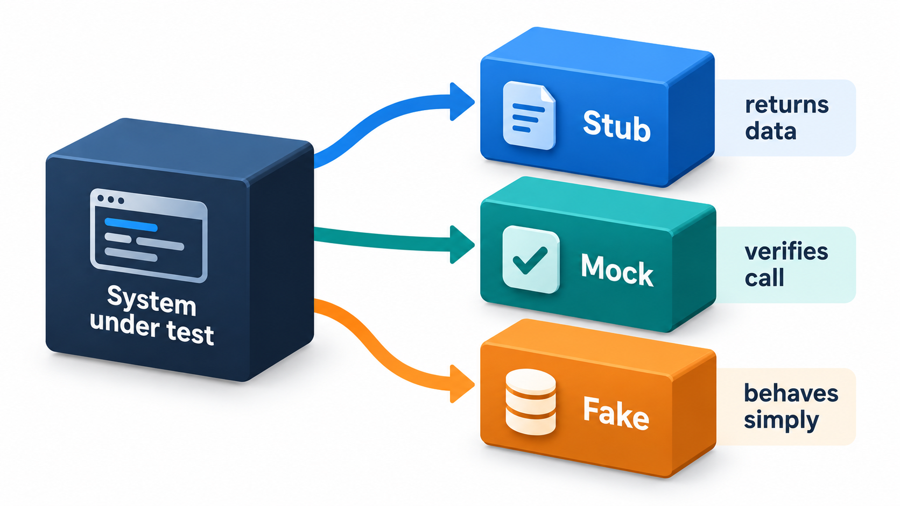
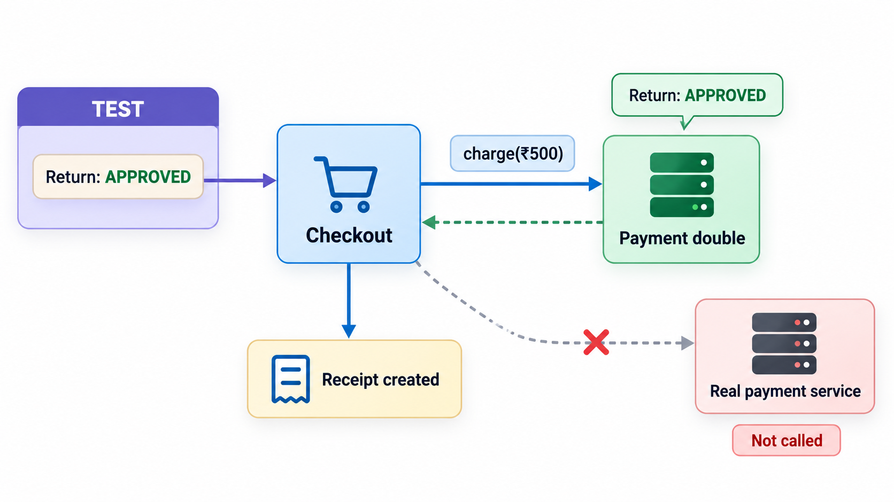
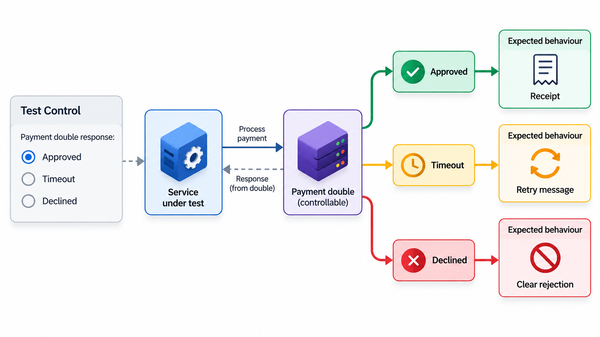
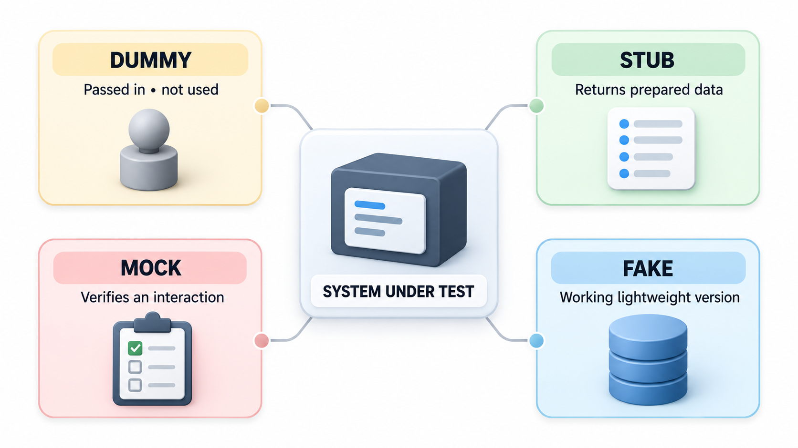
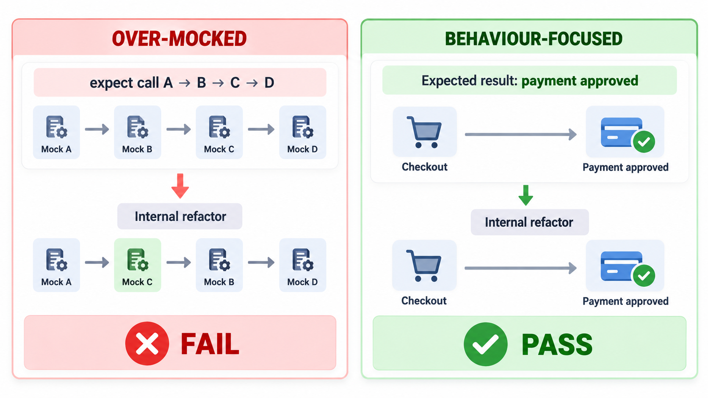

## Stand-ins for the Parts You Cannot Use

A good unit test must be fast, isolated and repeatable. But real code does not live in isolation. A fee module calls a payment gateway, which charges a real card. A report calls a database. A reminder sends an SMS to a real phone. A test that used the real thing would be slow, would cost money, would fail when the network did, and could not check what happens when the gateway refuses a card, since you cannot make a real gateway refuse on demand.

So the test substitutes a **test double**: any object that stands in for a real part of the system during a test, like a stunt double in a film. The vocabulary for the kinds, dummy, stub, spy, mock and fake, is still how developers talk about them. This topic explains what each does and when to use it.

## Why Doubles Are Needed

Four problems with real collaborators justify doubles.

| Problem with the real thing | Example | What the double gives |
| --- | --- | --- |
| **Slow** | A network call takes a second | Instant answers |
| **Unpredictable** | The current time, random numbers, live data | Fixed, known values |
| **Costly or dangerous** | Charging a card, sending SMS, deleting files | No side effects |
| **Hard to provoke** | Making the gateway time out or refuse | Failure on demand |

The last matters most. The error paths of a program, the code that handles refusals, timeouts and corrupt replies, are the least tested and the most likely to be wrong. Doubles make them testable.

## The Kinds of Double

The terms overlap in daily use, but each has a distinct job.

| Kind | What it does | Used when |
| --- | --- | --- |
| **Dummy** | Fills a parameter and is never used | The function needs an argument but the test does not care about it |
| **Stub** | Returns fixed answers to calls | You need the code under test to receive a particular input, such as "gateway says OK" or "gateway says declined" |
| **Fake** | A working but simplified version | An in-memory database or a fake payment service that keeps a balance, for tests that need realistic behaviour |
| **Spy** | Behaves like a stub and also records how it was used | You want to check afterwards what the code did, such as which amounts it sent |
| **Mock** | Is pre-loaded with expectations about calls, and fails the test if they are not met | You want the test to fail when the code does not call a collaborator in the expected way |

The deepest distinction is between **state verification** and **behaviour verification**. With stubs and fakes, the test checks the *result* or the *state* afterwards: did the receipt come out right? With spies and mocks, the test checks the *interactions*: was the gateway charged exactly once, with 500? Both are legitimate. State checks are less tied to how the code works inside, and interaction checks are right when the interaction itself is the behaviour that matters, such as "an email must be sent".

<!-- Visual: stubs, mocks and fakes replacing collaborators for different reasons. -->

## Three Doubles for One Job

Take a fee payment routine that asks a gateway to charge an amount and returns a receipt if the gateway says "ok". It can be tested with doubles of different kinds, one after the other.

| Double | What it does | What the test observes |
| --- | --- | --- |
| Stub | Always answers "ok" | The routine returns a receipt, so the success path is tested without any real payment |
| Fake | A simple but working version that keeps a running balance | After payments of 500 and 300 the balance is 800, so the test checks the effect and not just the answer |
| Spy | Records every amount it was asked to charge | After one payment the record holds just 500, so the test can inspect how it was used |

A second stub that always said "declined" would test the failure path, which a real gateway could not do on demand. The spy's record also allows the mock-style check: that the gateway was charged exactly once with 500. Mocking libraries automate this, with expectations set up beforehand, and the test fails if the call does not happen as expected.

<!-- Visual: A controllable test double replacing the real payment service during testing. -->

## Testing the Failure Paths

The real value of doubles appears in scenarios a real service could not produce on request.

| Scenario | Double behaviour | What the code should do |
| --- | --- | --- |
| Card declined | Stub returns "declined" | Show a clear message; record no receipt |
| Gateway times out | Stub raises a timeout | Retry once, then report that payment status is unknown |
| Gateway succeeds but the reply is lost | Stub raises an error after "charging" | Not charge twice on retry (idempotency check) |
| Gateway returns malformed data | Stub returns garbage | Reject safely and log the problem |
| Gateway is slow | Stub delays | Respect the timeout |

Each row would be nearly impossible to arrange with the real gateway, and each describes the kind of failure that causes real incidents.

## How the Code Gets the Double

For a test to substitute a double, the code must be written so that it can. The gateway is passed *in* to `pay_fee` as a parameter, instead of created inside it. This is **dependency injection**: the function states what it needs and is given it. In production the real gateway is passed. In a test, a double is. If the function created the real gateway inside, no test could replace it, and the code would be untestable without real payments. So testability and design go together: code that can take doubles is code with clear boundaries.

| Way of supplying the double | How it works | Comment |
| --- | --- | --- |
| **Constructor or parameter** | The collaborator is passed in | Clearest; preferred |
| **Setter** | A method sets the collaborator after creation | Allows change, but easy to forget |
| **Patching** | The test temporarily replaces a name in the program | Handy for legacy code; fragile |
| **Container configuration** | A framework supplies the right version for tests | Common in large applications |

## Over-Mocking: The Pitfall

Doubles are powerful and easily overused. A test with a mock for every collaborator and a long list of expected calls is tied to the *implementation*: it checks how the code works inside, step by step. Refactor the code to do the same thing differently, and the test fails though nothing is broken. Such tests give false alarms, discourage improvements and prove little, since a test that only verifies that mocks were called in a certain order can pass while the real parts, when joined, do not work.

Guidelines that help:

<!-- Visual: dummy, stub, mock and fake doubles supporting different test needs. -->

- **Prefer real objects** when they are fast and harmless, such as a simple calculator or a data class. Double only what is slow, unpredictable, costly or dangerous: networks, databases, clocks, payment services, random numbers.
- **Prefer fakes and stubs to mocks** where you can, and check outcomes and state.
- **Use mocks for real interactions**, where the call is the behaviour, such as sending an email.
- **Do not mock what you do not own** in ways that hide its real behaviour. Wrap the library in your own thin class and double that.
- **Keep a few tests with the real thing** at integration level, so that the doubles do not hide a mismatch.

| Test style | Refactor the internals | Break the behaviour |
| --- | --- | --- |
| Checks result with a stub | Still passes (correct) | Fails (correct) |
| Checks every internal call with mocks | Fails (false alarm) | Fails (correct) |
| Mocks everything and checks nothing about the result | Passes | Passes (dangerous) |

<!-- Visual: two tests of the same function, one with a mock for every collaborator and a long call list breaking after an internal refactoring, and one checking only the result and staying green. Save as images/95_over_mocking.png. -->

## Choosing a Double

| You want to... | Use |
| --- | --- |
| Fill a required argument that does not matter | Dummy |
| Feed the code a particular answer | Stub |
| Run against something realistic but cheap | Fake |
| Check what the code sent out, afterwards | Spy |
| Fail the test unless a specific call happens | Mock |

## Five Misreadings of Test Doubles

**"Mock and stub mean the same."** A stub supplies answers. A mock also holds expectations about how it will be called, and can fail the test.

**"Every dependency should be mocked."** Mock the slow, unreliable or dangerous ones. Real fast objects make better tests.

**"If the mocks are called correctly, the code works."** It may pass with mocks and fail with the real parts. Keep integration tests as well.

**"Doubles are only for tests of classes."** The idea applies at every level, from functions to services, including fake third-party APIs.

**"Needing many doubles is normal."** It often signals that a unit has too many dependencies and wants splitting.
