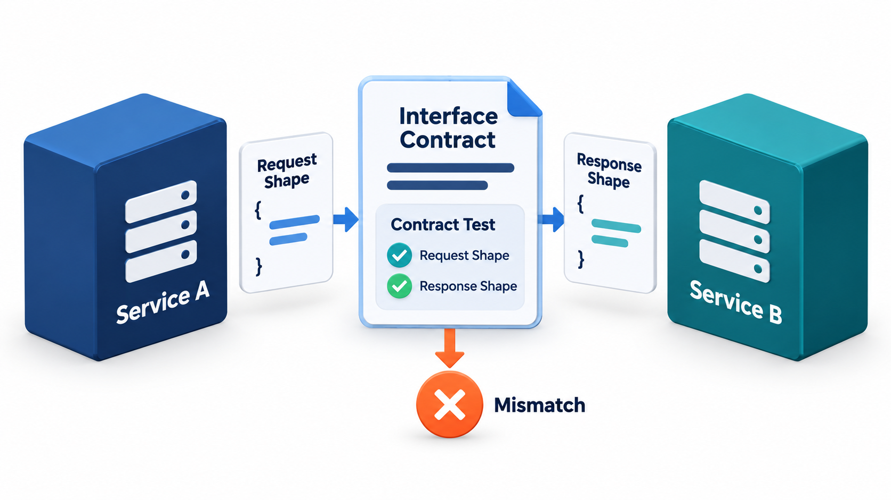
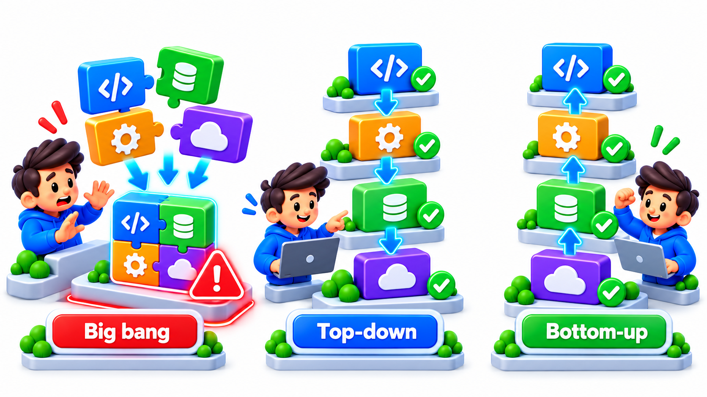
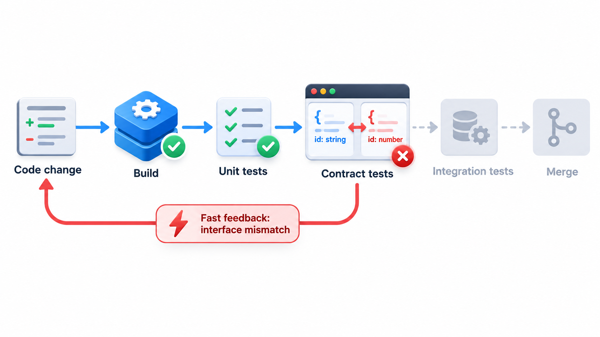
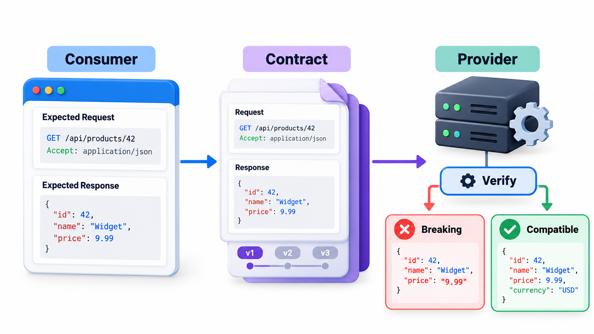
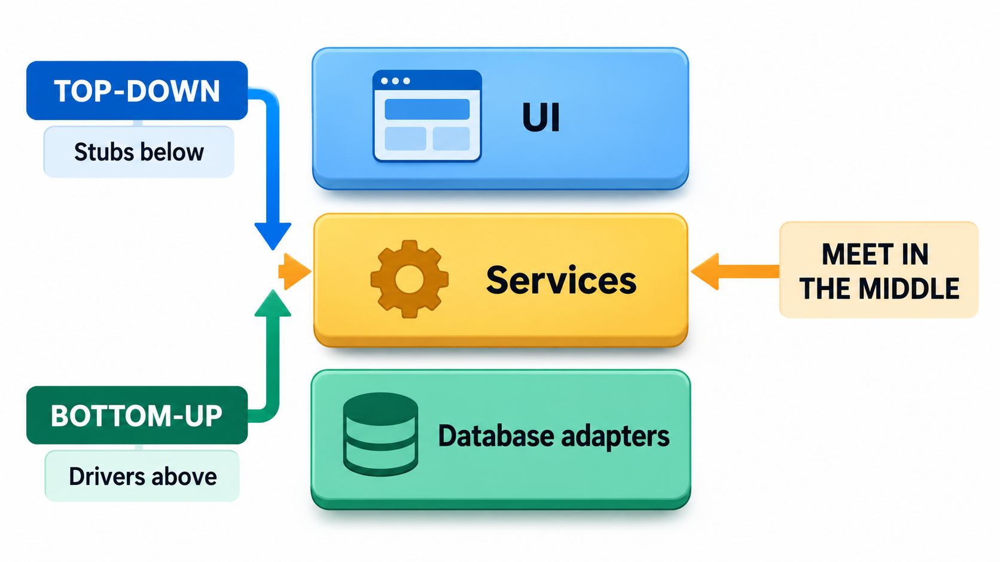

## Join the Parts One at a Time

If you build the parts of a system separately and join them all at once, every disagreement between them appears at the same moment, tangled together, with no way to tell which part is at fault. Large projects know this as "integration hell". Parts that each meet their specification may still not fit together as expected: one expects rupees where another sends paise, or one waits for a message the other never sends.

**Integration testing** strategies are different ways of deciding the order in which parts are joined and tested, so that the disagreements appear one by one while they are still small. They use two kinds of stand-in: a **stub**, which replaces a lower-level part that is not ready, and a **driver**, which replaces the caller of a part when the caller does not yet exist.

## What Integration Testing Looks For

Unit tests show that each part works alone. Integration tests check that parts work *together*. The faults they find are not in the logic of a single component. They are in the **interfaces**: a function that expects rupees and receives paise, a service that returns a date in a format its caller cannot read, a sequence of calls in the wrong order, a field that one side thinks is optional and the other thinks is required, an error that one part raises and no part handles.

| Interface fault | Example | Why unit tests miss it |
| --- | --- | --- |
| **Wrong units** | Rupees vs paise | Each side is consistent with itself |
| **Wrong format** | Date as 05/06 vs 06/05 | Each side parses its own format |
| **Wrong order** | Receipt requested before payment is saved | Each call works alone |
| **Missing field** | One side omits a field the other requires | Each side's tests supply the field |
| **Unhandled error** | Provider returns an error nobody catches | Tests use only successful replies |
| **Timing and concurrency** | Two parts update the same record at once | Tests run one part at a time |

<!-- Visual: A contract test catching mismatched requests and responses at an interface. -->

To test in stages, you often need parts that are not ready. Two kinds of scaffolding make this possible.

- A **stub** stands in for a component that the part under test *calls*, but which does not yet exist or is not wanted. It returns a canned answer.
- A **driver** stands in for a component that *calls* the part under test. It is test code that provides inputs and checks outputs.

Take a fee payment module that rejects bad amounts and otherwise asks a receipt service to produce a receipt. Here is one of each style.

| Style | What is real, and what stands in | Result |
| --- | --- | --- |
| Top-down with a stub | The payment module is real; the receipt service, not yet built, is a stub returning a fixed message | "STUB receipt for Asha": the module works with a stand-in below it |
| Bottom-up with a driver | The receipt service is real; a driver, test code, calls it directly because the caller does not exist yet | "Receipt: Ravi paid 300" |
| Real parts together | Payment module and real receipt service | "Receipt: Meena paid 800": the actual integration test |

Notice that the stub's output says "STUB". A reader can tell at once that the first test did not use the real service. The last row is the actual integration test, run when both parts are ready.

## The Strategies

**Big bang.** Build all the components, join them at once, and test the whole. It is simple to describe and risky. All interface faults appear together, mixed with each other, and the location of any one is hard to find. It suits only very small systems.

**Top-down.** Start with the top-level module and add the lower modules one at a time, using stubs for those not yet integrated. This tests the main control flow and the user-facing behaviour first, and shows a working skeleton early. The disadvantage is that stubs must be written for everything below, and the lower, often critical, modules are tested last.

**Bottom-up.** Start with the lowest-level modules, test them in groups using drivers, then combine upwards. The foundations are tested first and need no stubs. The disadvantage is that the system as a whole does not exist until the end, and design flaws at the top appear late.

**Sandwich (hybrid).** Work from both ends toward the middle: top-down for the upper layers and bottom-up for the lower ones, meeting in a middle layer. It speeds things up when different teams build different layers, at the price of more planning.

**Incremental in general.** All the strategies except big bang are incremental: they add one piece or a few at a time and test after each. A failure then points at the newest piece.

<!-- Visual: big-bang, top-down and bottom-up integration joining components in different orders. -->

| Strategy | Needs | Finds interface faults | Main weakness |
| --- | --- | --- | --- |
| **Big bang** | Nothing extra | All at once, tangled | Hard to locate faults |
| **Top-down** | Stubs | In order, from the top | Lower levels tested late |
| **Bottom-up** | Drivers | In order, from the bottom | No working system until late |
| **Sandwich** | Both | From both ends | Needs more coordination |

## Counting the Difference

The benefit of incremental integration can be shown by counting. Suppose a system of five modules has one interface fault in each of three joins.

| Strategy | When faults appear | Faults visible in the first failing run | Effort to locate each |
| --- | --- | --- | --- |
| Big bang | All at the single integration | Up to 3 at once, tangled | High: the cause could be any of 10 module pairs |
| Incremental | One at each join as it is added | 1 | Low: it is in the join just made |

With five modules, there are 10 possible pairs of connections. When everything is joined at once, a failure could lie in any of them. Adding one module at a time narrows the search to the new module's connections, a handful at most.

## Choosing a Strategy

| Situation | Suitable strategy | Reason |
| --- | --- | --- |
| Small system, few interfaces | Big bang may do | Little to untangle |
| User-facing flow is the main risk | Top-down | Shows the skeleton early |
| Low-level services are critical (payments, data) | Bottom-up | Foundations are proven first |
| Several teams build different layers | Sandwich | Both ends progress in parallel |
| A modern web service with frequent releases | Continuous integration with contract tests | Integration happens all the time |

## Continuous Integration Changes the Picture

Modern teams reduce the problem by integrating all the time. Under **continuous integration**, every change is merged into the shared code several times a day and a build runs the tests, including integration tests. The "integration" is then never a big event, since there is never much that is new. It does not replace a strategy: the question of the order in which new components are joined still arises when a new service or module is added.

Integration tests often need real dependencies, a database, a message queue, another service. Teams run them against test versions, started automatically for the run, often in containers, so that the tests do not depend on a shared environment that someone else may change.

## What an Integration Test Looks Like

An integration test sits between a unit test and an end-to-end test. A typical one starts a real database, creates a student through the data layer, calls the fee module, and checks that a row appears in the table and the receipt reads it back.

| Part | Real or double? | Reason |
| --- | --- | --- |
| Fee module | Real | The thing being tested |
| Data layer | Real | The interface being tested |
| Database | Real (a temporary test instance) | Interface faults appear only against the real thing |
| Email service | Double | Not part of this integration; slow and with side effects |
| Clock | Double | Fixed date for repeatable results |

The art is choosing what to include. Everything that is part of the interface under test should be real. Everything unrelated can be replaced.

## Contract Tests for Services

When parts are separate services owned by different teams, the interface is an API, and breaking it breaks the callers. A **contract test** checks that a provider still delivers what its consumers expect, and that a consumer sends only what the provider accepts. The consumer states the contract, for example "when I ask for a student, I expect a name and a fee_due", and the provider's build runs a test against it. A change that would break a consumer then fails the provider's own build, before release.

<!-- Visual: sandwich integration drawn as three layers of modules, with the top layer integrated downwards using stubs, the bottom layer integrated upwards using drivers, and both meeting in the middle. Save as images/96_sandwich_integration.png. -->

