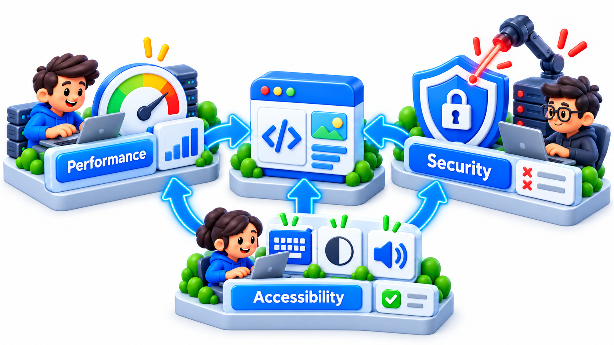
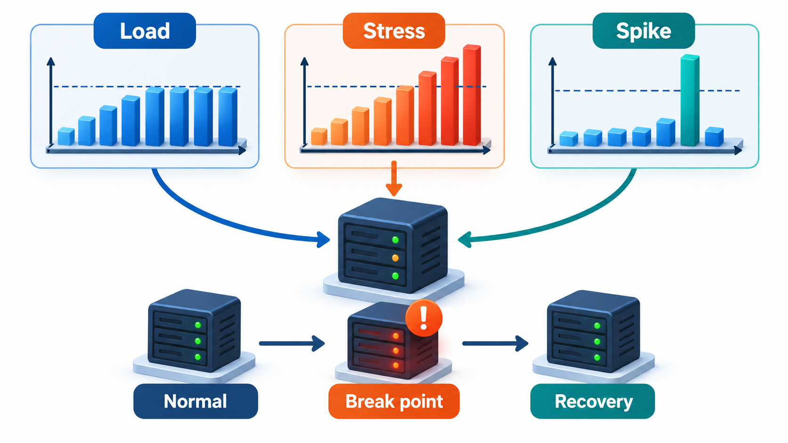
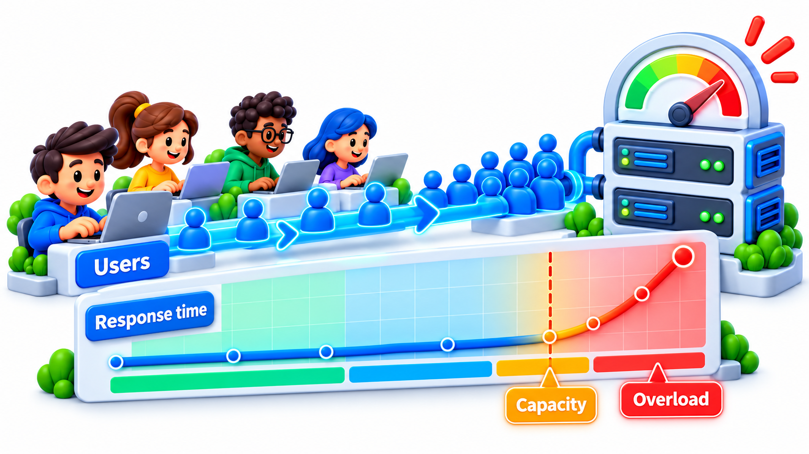
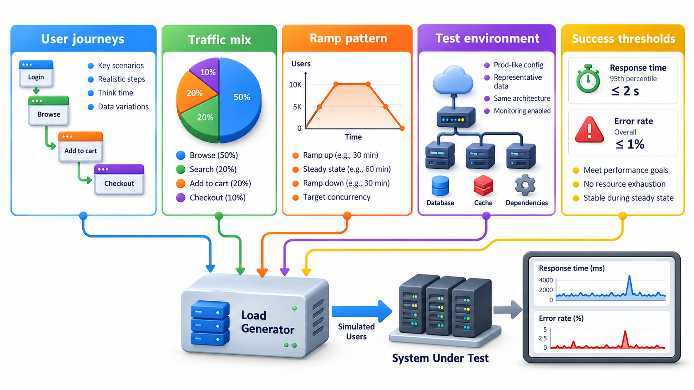
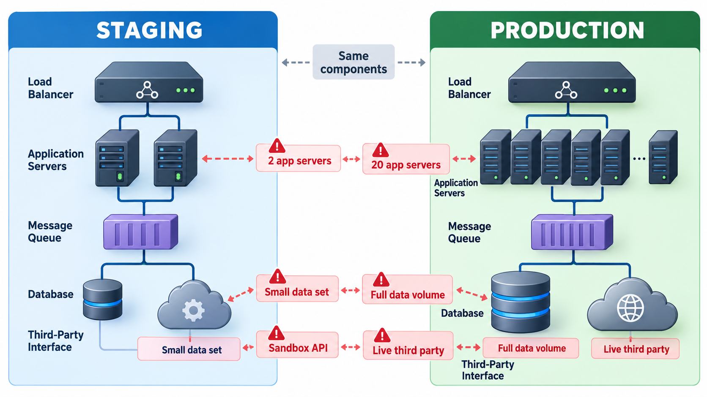

## The Whole Product Under Realistic Conditions

A product can have every feature tested and still surprise its makers on the day many people use it at once. The logic of the screens may be perfect, and the system may still fall over when thousands arrive in the same minute. **System testing** treats the complete, integrated product as a single whole and checks it, in an environment as close to the real one as possible, against its requirements.

That covers more than whether the features work. It covers how fast, how many at once, on which devices, with what security, and how the system recovers when something fails. This topic covers the main kinds, with the most surprising first: performance and load.

System testing is often the first time the product exists in one piece. Before it, testers have seen components and combinations. Now they can ask questions that only a whole can answer: does a journey that crosses five modules still work, does the system survive a bad day, and would a stranger be able to use it?

## What System Testing Covers

At this level the testers have the whole product and test it as users and the world will meet it. Several kinds of test are usual.

| Kind | The question | Examples |
| --- | --- | --- |
| **Functional** | Does each feature work as specified, end to end? | A student logs in, pays a fee, gets a receipt |
| **Performance and load** | How fast is it, and how does it behave with many users? | 5,000 students register in ten minutes |
| **Usability** | Can real people use it without help? | A first-time user completes a payment unaided |
| **Compatibility** | Does it work on the devices, browsers and systems people have? | Android 9 to 14, Chrome and Safari, small screens |
| **Security** | Can it be misused or broken into? | Attempts at guessing passwords, injecting commands |
| **Recovery and reliability** | Does it cope with failures? | The database restarts in the middle of a payment |
| **Installation and configuration** | Can it be deployed and set up? | A fresh install, an upgrade, a rollback |

These are the tests that no lower level can do. A unit test cannot say that the whole system slows to a crawl at 10,000 users, or that the layout breaks on a small phone.

<!-- Visual: performance, security and accessibility needing distinct test labs. -->

## Functional and Non-Functional Testing

A useful split is between what the system does and how well it does it.

| Type | Concerned with | Typical requirement | Typical test |
| --- | --- | --- | --- |
| **Functional** | Behaviour | "A student can pay by UPI" | Make a UPI payment and check the receipt |
| **Non-functional** | Qualities | "The results page loads within 2 seconds for 95% of users" | Load test measuring the 95th percentile |
| | | "No data lost if a server fails" | Kill a server during payments; check records |
| | | "Works on a 5-inch screen" | Run on small devices |

Non-functional requirements are the ones most often unstated and most often the cause of unhappy launches. A product that does everything asked, slowly and insecurely, has failed.

## Performance and Load Testing

The performance tests have their own vocabulary.

- **Load test.** Apply the expected number of users and check response times against the requirement.
- **Stress test.** Push beyond the expected load, to find where the system breaks and how it fails: gracefully, or with a crash and lost data.
- **Spike test.** A sudden jump, like a match starting or a result being published, to see whether the system copes with the surge.
- **Soak (endurance) test.** Run at normal load for many hours to find slow problems, such as memory that leaks until the server falls over.

<!-- Visual: load, stress and spike tests applying different traffic patterns. -->

A well-known feature of the results is that response times do not rise gently. They stay flat until the system gets busy and then climb sharply. A simple queueing relation shows why: the average response time is the service time divided by (1 minus how busy the server is). Say a server needs 50 milliseconds for a request, so it can handle 20 a second at most.

| Requests per second | Server busy | Response time |
| --- | --- | --- |
| 4 | 20% | 62 ms |
| 10 | 50% | 100 ms |
| 16 | 80% | 250 ms |
| 18 | 90% | 500 ms |
| 19 | 95% | 1,000 ms |
| 19.8 | 99% | 5,000 ms |

When the server is idle, the response time is just the service time. Look at the last rows: a 9 per cent increase in load, from 90 to 99 per cent, makes responses ten times slower. This is why load tests look for the knee of the curve, and why a system running at 95 per cent of its capacity is in danger even though it has not failed. A load test finds the knee before the users do.

<!-- Visual: response time rising sharply once user load exceeds capacity. -->

## Planning a Load Test

A load test needs a realistic model of use, not just a large number of requests.

| Decision | Question | Example |
| --- | --- | --- |
| **Expected peak** | How many users at the busiest moment? | 8,000 students on results day, 80% in the first 10 minutes |
| **Mix of actions** | What do they do? | 70% view results, 20% download a mark sheet, 10% raise a query |
| **Think time** | How long between actions? | 20 to 60 seconds, as people read |
| **Data** | What volume and shape? | Realistic numbers of students and results |
| **Targets** | What counts as passing? | 95% of page loads under 2 seconds, no errors above 0.1% |
| **Ramp** | How quickly does load build? | From zero to peak in 5 minutes, then sustain for 30 |

From the figures: 8,000 users with 80% arriving in 10 minutes is 6,400 users in 600 seconds, about 11 new users a second. If each does about one request every 40 seconds, a few hundred requests a second reach the system at peak, and the test must show it can serve that with the target response time.

## Testing Beyond the Happy Path

System testers think about what could go wrong in the real world: a user with a slow connection, one who presses the back button halfway through a payment, one whose clock is wrong, a database full of old data from before a migration, a disk that fills up. They test with realistic data volumes and not with five sample rows. They check what happens when a dependency is slow or down. They are the first to meet the product as a whole, so they often notice what it is like to use.

| Scenario | What it checks |
| --- | --- |
| Network drops during payment | No double charge; clear status afterwards |
| Back button after submitting | No duplicate submission |
| Two tabs open as the same user | Consistent data |
| Database restart under load | Recovery without data loss |
| Disk nearly full | Errors reported, not silent corruption |
| Upgrade from last version with real data | Data migrates correctly |
| Time zone or clock change | Dates and deadlines stay right |

## The Test Environment

System tests need an environment resembling production: the same kinds of server, the same configuration, similar data in volume and shape. The closer the match, the more a result can be trusted. Teams keep a **staging** environment for this purpose. Using real customer data in tests brings privacy risk, so teams use anonymised or generated data. The differences between staging and production should be known, since each one is a place where a problem can hide.

<!-- Visual: a staging environment mirroring production with the same components, scaled down, and a list of known differences (data volume, server count, third-party sandboxes) marked as risks. Save as images/97_staging_vs_production.png. -->

| Difference | Risk it creates |
| --- | --- |
| Fewer servers in staging | Load results do not scale directly to production |
| Smaller data set | Slow queries remain hidden |
| Third-party sandbox instead of the real service | Real service behaves differently |
| Different configuration | A setting that works in staging fails in production |
| No real traffic patterns | Unexpected usage goes untested |

## Reporting System Test Results

The output of system testing is information for a decision. A useful report states what was tested and not tested, what was found, how serious it is and what risks remain.

| Section | Content |
| --- | --- |
| **Coverage** | Which requirements and risks were tested; which were not |
| **Results** | Passed, failed, blocked |
| **Open defects** | By severity, with known workarounds |
| **Performance** | Measured response times and capacity against targets |
| **Risks** | What remains uncertain, and why |
| **Recommendation** | Release, release with conditions, or hold |
