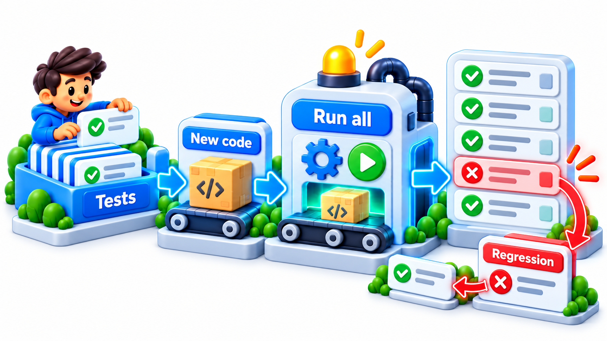
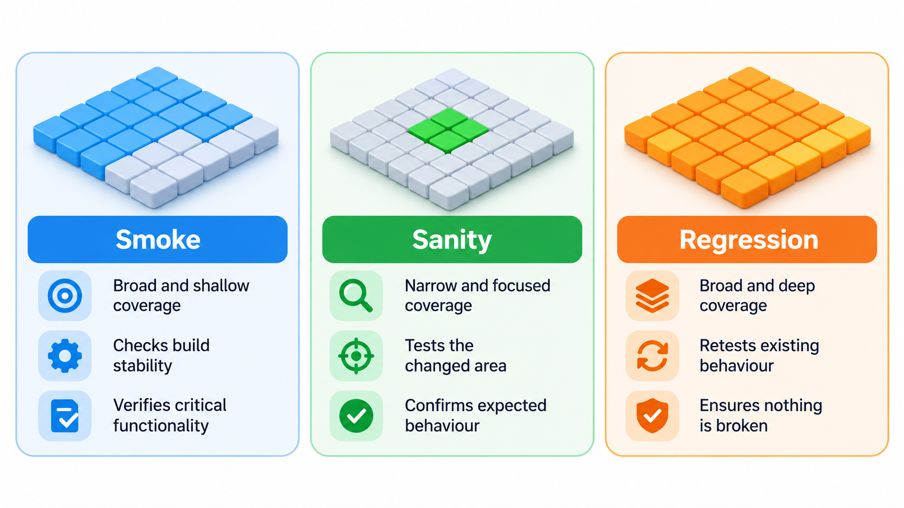
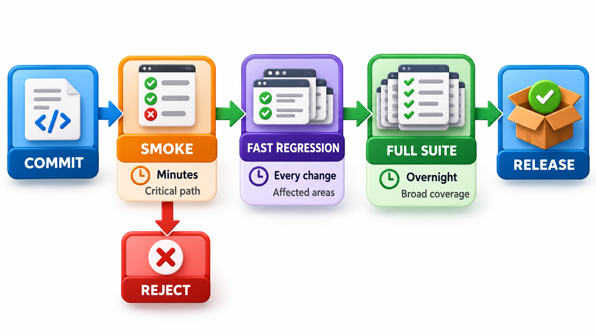
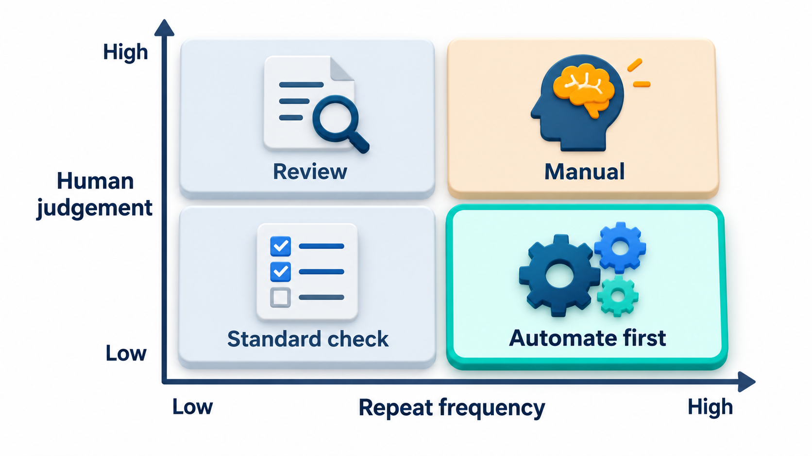
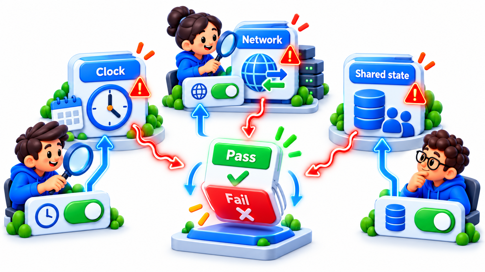

## Guarding Against Yesterday's Features Breaking

Users trust that what worked yesterday works today. A **regression** is something that worked in an earlier version and stopped working after a change, and nobody plans one: the change is somewhere else, and the damage is somewhere nobody was looking. Regressions are among the most common and most damaging defects, which is why a family of tests exists to guard against them.

This topic covers three: **regression testing**, which re-runs earlier tests after a change; **smoke testing**, a quick check that the build is alive at all; and **sanity testing**, a narrow check that a particular change or fix behaves reasonably.

Regressions are painful because they destroy trust. A user who finds that something which used to work no longer does feels the product is going backwards. They are also the most preventable kind of defect, because the correct behaviour was known: it used to work.

## Why Changes Break Things

A change breaks things at a distance because software parts depend on one another in ways nobody has listed.

| Cause | Example |
| --- | --- |
| **Shared code** | Fixing a date function for one screen changes every screen that uses it |
| **Shared data** | A new field format breaks a report that reads the old format |
| **Hidden assumptions** | A module relied on a side effect that the change removed |
| **Configuration** | A new setting default alters behaviour elsewhere |
| **Dependencies** | A library upgrade changes the behaviour of a function |
| **Merging** | Two people's correct changes conflict when combined |

The larger and older the product, the more of these links exist and the harder they are to see, which is why testing for regression cannot rely on the developer's memory of what the change might touch.

## Regression Testing

A **regression test** re-runs tests that passed before, after a change, to check that the change has not broken anything that already worked. The collection of such tests is the **regression suite**. Every bug fixed, every feature added and every test that passed once becomes a candidate.

The suite grows as the product does, and so it tends to be automated. A suite of a thousand tests that is run by hand is run rarely, and a regression that is found a month later is expensive. The same suite run by a machine after every change shows a break within minutes, when the cause is still clear.

A good habit is to turn each bug that is fixed into a test. Once the bug is fixed, a test that would have caught it stays in the suite, so it can never silently come back. Over the years, the suite becomes a record of everything that has ever gone wrong.

<!-- Visual: A regression suite re-running accumulated checks after every change. -->

## Kinds of Retesting

Two words are easily confused.

| Term | Purpose | Example |
| --- | --- | --- |
| **Retesting (confirmation testing)** | Check that a specific fixed bug is really fixed | Re-run the exact steps that exposed the fine-cap bug |
| **Regression testing** | Check that the fix and other changes did not break something else | Run the fee, receipt and report tests after the fix |

Retesting looks at the thing that was broken. Regression testing looks at everything around it.

## Choosing What to Run

As a suite grows, it takes longer. A full run of ten thousand tests might take hours. Teams cannot wait for hours after every small change, so they choose.

- **Run everything, rarely.** The complete suite overnight or before a release.
- **Run a fast subset often.** The most important tests on every change.
- **Select by change.** Run the tests that relate to the code that was changed. Tools can map tests to code and pick those affected.
- **Prioritise.** Run first the tests that have failed recently or cover the riskiest areas, so that a failure is found early.

A large suite takes a long time to run, so teams choose the tests that matter for each change. Change-based selection labels each test with the modules it touches and runs those that touch what changed, plus the smoke test, which always runs. Take six tests and a change to the fee module.

| Test | Modules it touches | Runs? |
| --- | --- | --- |
| Smoke: app starts and login works | Core | Yes, always |
| Fee calculation | Fees | Yes |
| Late fine | Fees | Yes |
| Receipt layout | Receipts | No |
| Report totals | Fees and reports | Yes, because it depends on fees |
| Hostel booking | Hostel | No |

Four of the six tests run. The receipt layout and hostel booking tests are skipped, since the change cannot affect them. The saving here is a third, and in a real suite with thousands of tests it can be much more. The risk is in the mapping: if it is wrong, a test that should run is skipped. Teams therefore still run the complete suite regularly as a backstop.

## Smoke Testing

A **smoke test** is a quick, shallow check that the most basic functions of a build work at all: it starts, you can log in, the main page loads, a simple transaction goes through. The name comes from hardware: when you first power on a new circuit, you see whether smoke comes out. It is not meant to find subtle bugs. It decides whether the build is worth testing further. If the smoke test fails, the build is rejected at once and no one wastes time on a thing that does not start.

Smoke tests run after every build and after every deployment, including a deployment to production, where a handful of safe checks confirm that the release is alive. They must be fast, a few minutes at most.

A typical smoke list for a fee portal:

| Check | Why it is in the list |
| --- | --- |
| Home page loads | The site is up |
| Login works for a test account | Authentication and database are reachable |
| A student's fee page displays | Core data path works |
| A test payment completes in the sandbox | The key transaction works |
| Logout works | Session handling works |

Five checks, two minutes. If any fails, the deployment is rolled back or stopped.

## Sanity Testing

A **sanity test** is a narrow, quick check of a specific area after a small change or a fix, to see whether it is reasonable to continue. If a bug in the late fine was fixed, the sanity test checks the late fine, a few cases, and the features around it. It is deeper than a smoke test in that area and does not cover the rest. The words smoke and sanity are used loosely, and many teams treat them as the same. The distinction that helps: smoke is broad and shallow, to see whether the build is testable at all, and sanity is narrow and a little deeper, to see whether a particular change makes sense.

<!-- Visual: a pipeline in which a build passes through a smoke test, then a fast regression subset on every change, then the full suite overnight, with a rejected build at the first gate. Save as images/98_layered_regression_pipeline.png. -->

| Test | Scope | Depth | When | Question |
| --- | --- | --- | --- | --- |
| **Smoke** | The whole build | Shallow | Every build or deployment | Does it work at all? |
| **Sanity** | One area | A bit deeper | After a fix or small change | Does this change make sense? |
| **Regression** | The whole product | Thorough | After changes, before release | Did we break anything? |

<!-- Visual: high-frequency, low-judgement tests being the best candidates for automation. -->

## What to Automate

Not every test is worth automating. A simple rule asks how often the test will run and how much judgement it needs.

| Test | Frequency | Judgement | Decision |
| --- | --- | --- | --- |
| Smoke checks | Every build | None | Automate first |
| Fee and fine calculations | Every change | None | Automate |
| Login and payment flows | Every release | None | Automate the critical paths |
| "Does the new layout look right?" | Once | High | Do by hand |
| Exploration of a new feature | Once | High | Do by hand |
| A flow that changes every sprint | Often changes | None | Delay automation until it stabilises |

Automation has a cost to write and to maintain. A test that will run a thousand times repays it quickly; a test that will run twice does not.

## Keeping the Suite Healthy

A regression suite is useful only while people trust it. The greatest threat is **flaky tests**, tests that sometimes pass and sometimes fail with no change in the code, caused by timing, shared data or the network. People learn to ignore a flaky failure, and then they ignore a real one. Teams quarantine flaky tests, fix them or delete them. Other problems are tests that nobody understands, tests that take too long and tests made obsolete by changed features. A suite needs pruning, as a garden does.

| Problem | Effect | Remedy |
| --- | --- | --- |
| Flaky tests | Failures are ignored | Quarantine, find the cause, fix or delete |
| Slow suite | Run rarely | Parallel runs, faster tests, subsets |
| Obsolete tests | Noise; false failures | Remove when features change |
| Duplicate tests | Cost without benefit | Merge |
| Untraceable failures | Long investigations | Clear names and messages |
| Tests nobody owns | Decay | Assign owners per area |

<!-- Visual: flaky tests changing outcome because of time, network or shared state. -->

## Five Misreadings of Regression Testing

**"Regression testing is repeating old tests for no reason."** It is the only protection against the damage that new changes do to old features.

**"Smoke and sanity are the same."** Smoke is a broad shallow gate on a build. Sanity is a narrow check on a change.

**"Run only the tests for what you changed."** The effects of a change can reach far. Selection saves time but needs a backstop of full runs.

**"Failed regression means the new feature is bad."** It means something that worked has broken. The new feature may be fine.

**"Flaky tests are a minor nuisance."** They destroy trust in the suite, and must be fixed or removed.
