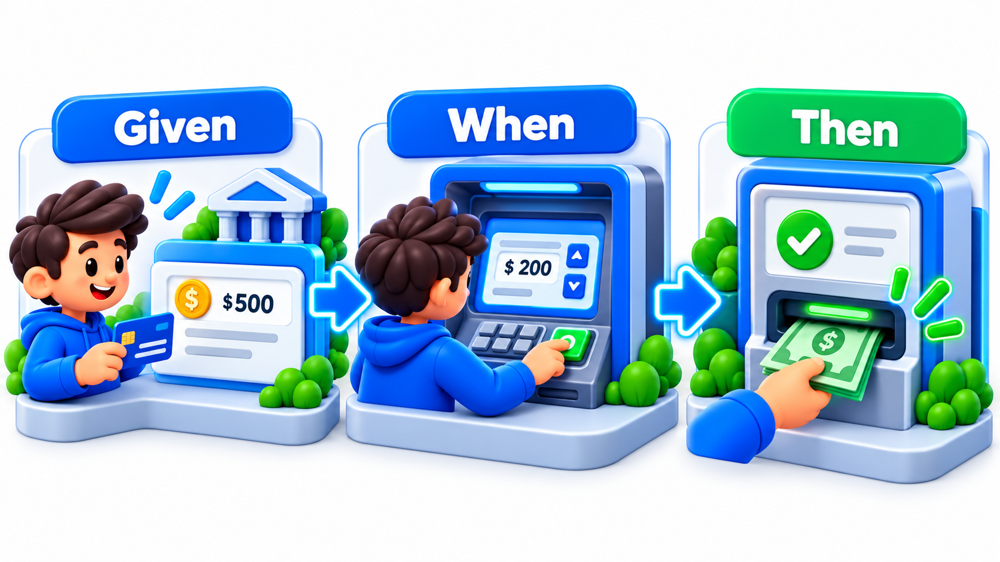
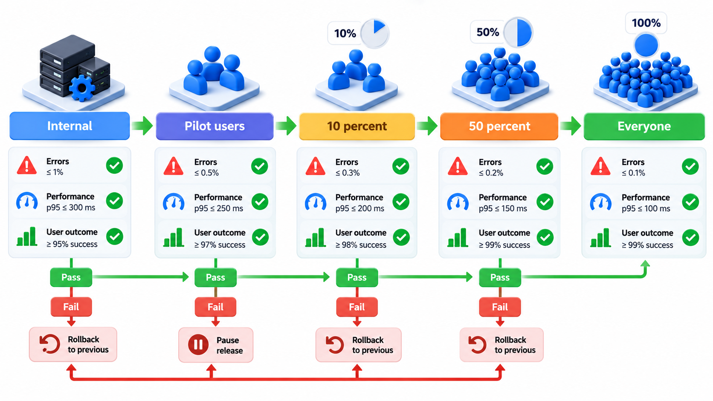
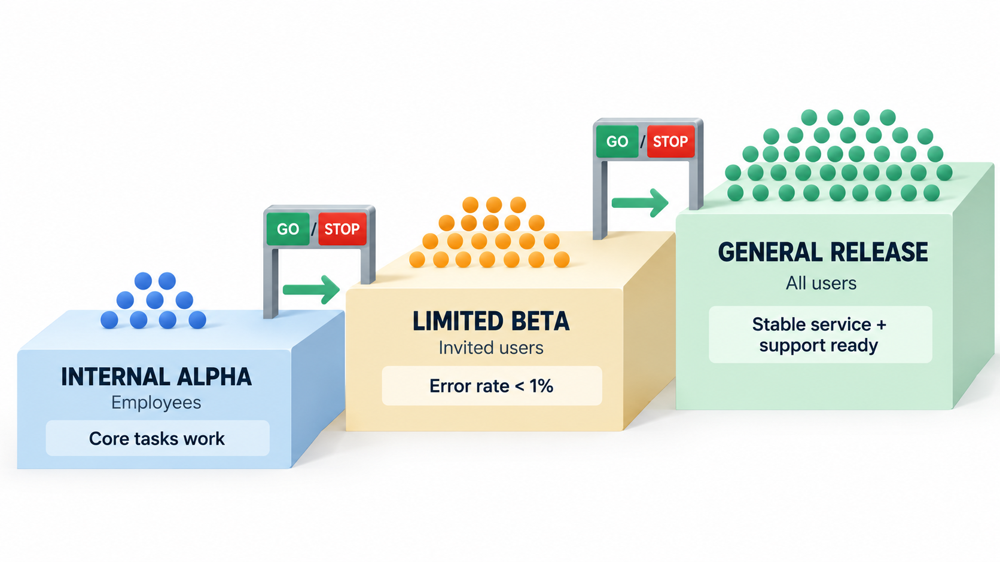
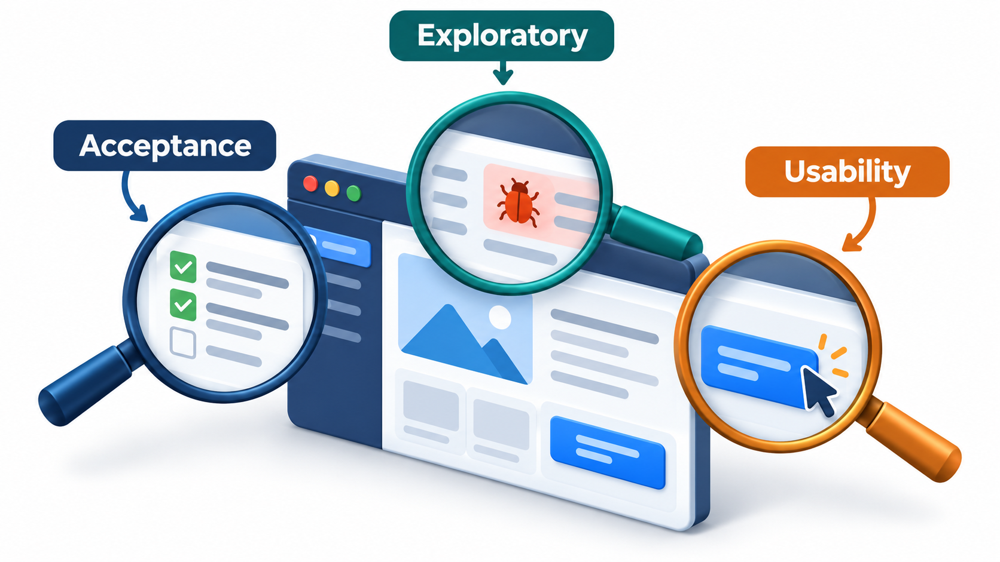

## The People It Is For Make the Final Call

Developers say the software is finished. Testers say it passes. Neither is the final judge. The final judge of software is the people it is for. **Acceptance testing** is the stage at which they decide whether the system does what they need, in their own conditions, and whether they will accept it.

It takes several forms: user acceptance testing by the customer's staff, checks against contractual criteria, and **beta testing**, in which a limited group of real users tries the product in real conditions, letting the makers learn what breaks without promising perfection. This topic covers them and ends with who decides, and what happens on failure.

The reason this level exists is simple: a specification is somebody's best attempt to describe a need, and attempts are imperfect. The only way to find out whether the need has really been met is to put the product in the hands of the people who have it.

## What Acceptance Means

Acceptance testing asks whether the product is acceptable to the customer or the user: does it meet the need it was built for, and are they willing to take it? It differs from the earlier levels in who is asking. Unit, integration and system tests are run by the team to check that the product matches its specification. Acceptance tests are run, or at least approved, by the customer to check that the product matches their *need*. A system can match its specification perfectly and still not be what the customer wanted, because the specification was wrong or incomplete.

In the usual terms, acceptance testing is mainly **validation**: checking that the right product was built. It is also the point at which a contract may be settled: in a project built for a client, passing the acceptance tests is the condition for the final payment.

| Question | Verification (earlier levels) | Validation (acceptance) |
| --- | --- | --- |
| Are we building the product right? | Yes: checks against the specification | |
| Are we building the right product? | | Yes: checks against the need |
| Who judges? | The team | The customer or user |
| What does failure mean? | A defect in the build | Possibly a defect in the specification |

## Kinds of Acceptance Testing

**User acceptance testing (UAT).** Representatives of the real users try the system with realistic tasks and data, in a setting like their working conditions. They are not testers. They are, for example, the accounts clerks who will use the fee system every day, and their question is "can I do my work with this?".

**Business acceptance testing.** The owners of the business process check that the product supports it, handles the rules and produces the right reports.

**Contract (or customer) acceptance testing.** The product is checked against criteria written into the contract. It is formal: the criteria are agreed in advance, the results recorded and a sign-off issued.

**Operational acceptance testing.** The operations staff check that the product can be run: installed, backed up, monitored, restored after a failure, and upgraded.

**Alpha and beta testing.** Used mostly for products sold to many customers. **Alpha** testing is done by internal staff or a small trusted group, at the developer's site. **Beta** testing is done by real external users in their own environment, before general release. Gmail's invitation phase was beta. Beta testers find problems that no test lab can anticipate, from the variety of real devices and habits.

| Kind | Who tests | Where | Aim |
| --- | --- | --- | --- |
| UAT | Real users' representatives | Staging, with realistic data | Can I do my work? |
| Business acceptance | Process owners | Staging | Does it follow our rules and reports? |
| Contract acceptance | Customer, against the contract | Agreed environment | Are the signed criteria met? |
| Operational acceptance | Operations staff | Production-like | Can we run, back up and restore it? |
| Alpha | Internal staff | Developer's site | Catch obvious problems before outsiders see it |
| Beta | Selected external users | Their own environment | Learn from real conditions |

<!-- Visual: acceptance, exploratory and usability testing answering different questions. -->

## Acceptance Criteria as Tests

The best acceptance tests come from the **acceptance criteria** that were agreed with the customer when the requirement was written, in a Given-When-Then form: *given* a student with a fee due, *when* they pay by UPI, *then* they receive a receipt by SMS within a minute. A criterion in that form is both a statement of what the customer wants and a test that can be run. Agreeing them early means that "done" has an agreed meaning before work begins. Many teams automate them, so they run as part of every build and serve as a living statement of what the product is accepted to do.

| Part | Meaning | Example |
| --- | --- | --- |
| **Given** | The starting situation | A student with Rs 5,000 fee due |
| **When** | The action | The student pays Rs 5,000 by UPI |
| **Then** | The observable outcome | The fee shows as paid and an SMS receipt is sent within a minute |

A good criterion is specific, measurable and agreed by both sides. "The system should be fast" is not a criterion. "The results page loads in under two seconds for 95 per cent of requests" is.

<!-- Visual: given, When and Then structuring one behaviour as a shared example. -->

## Running a User Acceptance Test

A UAT needs preparation if it is to give useful answers.

| Step | What is done | Why |
| --- | --- | --- |
| 1. Choose participants | Real users, from each role | Different roles use different parts |
| 2. Prepare scenarios | Tasks from their real work, not technical scripts | Tests fit the need |
| 3. Prepare data | Realistic and anonymised | Problems appear with real shapes of data |
| 4. Brief them | What to do, how to report, that the product is being tested, not them | Reduces anxiety; improves reports |
| 5. Observe | Watch, note hesitation and workarounds | Silent confusion tells more than complaints |
| 6. Collect results | Pass, fail and comments per scenario | Evidence for the decision |
| 7. Decide | Accept, accept with conditions, or reject | Agreed rules, set beforehand |

Hesitation is a result. A clerk who finds the answer but takes four minutes where they used to take one has told the team something important, even though the test "passed".

## Releasing in Stages

Beta testing can be done gradually, as a staged rollout: release to a few, check, and widen only if all is well. The check is a measurable acceptance criterion, such as an error rate below a limit. Suppose the criterion is fewer than two errors per hundred sessions, agreed before the rollout.

| Stage | Sessions | Errors | Rate per 100 sessions | Decision |
| --- | --- | --- | --- | --- |
| Internal staff | 120 | 1 | 0.83 | Within limit: go on |
| 10% of users | 2,000 | 14 | 0.70 | Within limit: go on |
| 50% of users | 10,000 | 310 | 3.10 | Over the limit: stop and fix |

The earlier stages did not show the problem because it needed a larger, more varied population to appear. At 50 per cent the rate is above the limit and the rollout stops. The remaining half of the users were never exposed to the problem. Agreeing the criterion before the rollout is what turns the decision into a check and not an argument. This is the value of a staged beta: real users find what a lab does not, and the damage is limited to a fraction of them.

## Who Decides, and What Happens on Failure

Acceptance testing ends in a decision: accept, accept with conditions, or reject. The decision belongs to the customer or their representative, and not the developers. Conditions might be a list of defects to be fixed within an agreed time. To make this work, the team and customer agree beforehand what counts as a blocking failure and what is a minor issue. Without that agreement, acceptance turns into a negotiation over every defect.

| Defect found in acceptance | Blocking? | Typical outcome |
| --- | --- | --- |
| Payment fails for one bank | Yes | Rejected until fixed |
| Report total off by one rupee | Yes, if money | Fixed before acceptance |
| Button label slightly unclear | No | Accepted; fixed in the next release |
| Slow on very old devices | Depends on the users | Agreed condition |

<!-- Visual: an acceptance ladder from internal alpha through limited beta to general release, each step with an audience size, a measurable criterion and a go or stop decision. Save as images/99_acceptance_ladder.png. -->

Acceptance testing also complements the testing that precedes it. Its value is that it brings in fresh eyes and real needs. Its weakness is lateness: if it shows that the product is wrong, the cost is high. That is why agile teams involve the customer throughout, with a review at the end of every short cycle, so that the final acceptance contains no surprises.

<!-- Visual: acceptance, exploratory and usability testing revealing different truths. -->

